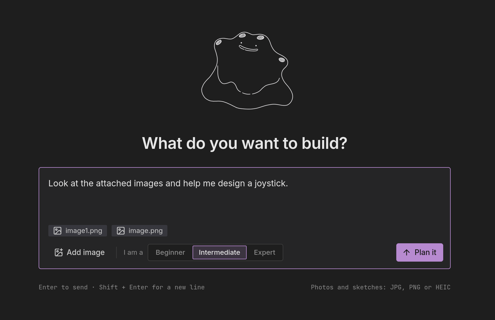
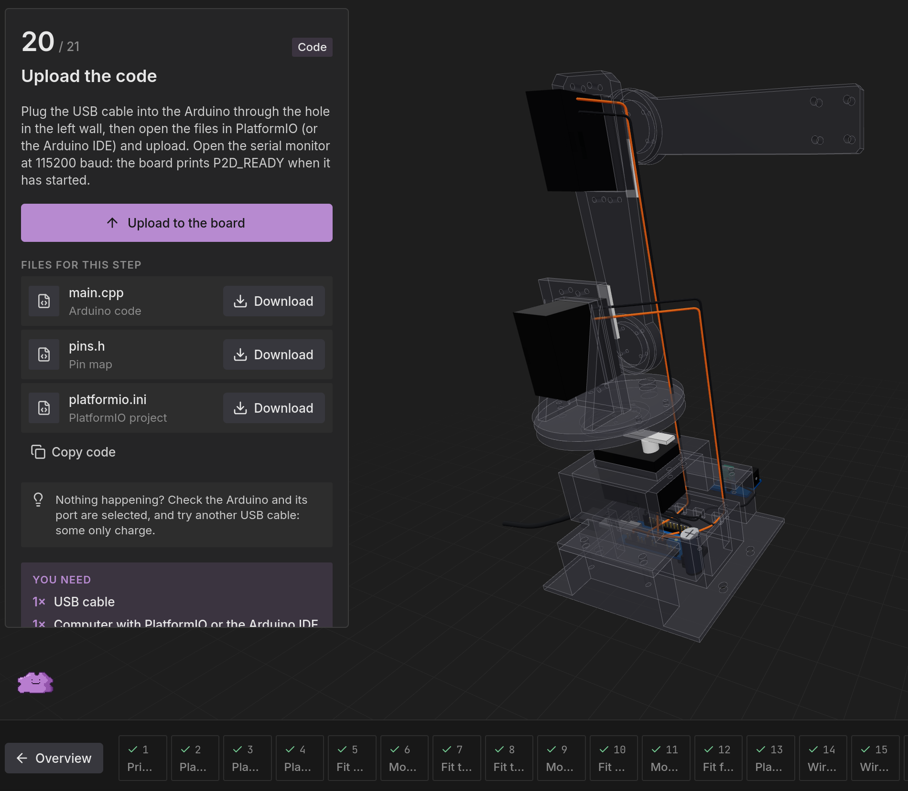

# Ditto


A web app that turns a text prompt, a sketch or a short video into a buildable physical project: a
3D-printed object, a microcontroller device (ESP32, Arduino Uno/Nano, Raspberry Pi Pico), or both.

For a device, Ditto makes:

- a parts list with prices (reusing parts you already own),
- a wiring plan,
- compiled Arduino firmware (optionally run in the Wokwi simulator),
- a printable case, either a plain box and lid or a custom body the model writes around it,
- a 3D view of the assembled device and a step-by-step build guide.



For a print-only object (`mcu: null`) it makes just the printed parts, from build123d code the model
writes and plain code runs and checks.

A deepagents orchestrator plans the project and delegates to sub-agents (parts and pins, firmware,
enclosure). Plain code checks every model output before the UI shows it. The project spec
(`ProjectSpec`) is the single source of truth: everything else is generated from it, so an edit like
"add a buzzer" updates firmware, wiring, BOM and enclosure together.

## How it fits together

```
prompt / sketch / video
        │
        ▼
  preprocess_input ──► agent (orchestrator + sub-agents) ──► ProjectSpec
                                                                │
        ┌───────────────┬───────────────┬───────────────┬──────┴────────┐
        ▼               ▼               ▼               ▼               ▼
   validate +       layout +        firmware        wiring +        pricing /
   cross-checks     enclosure /     (pins.h,        simulation       BOM
                    custom model +  compile, lint)  (Wokwi)
                    assembly
        └───────────────┴───────────────┴───────────────┴───────────────┘
                                        │
                              events + files in runs/<id>/
                                        │
                                        ▼
                    web UI: planning → overview (chat edits) → build guide
```

Each stage emits events (`queued`, `running`, `passed`, `failed`, `skipped`, ...) that the UI streams.
A stage whose dependency (an API key, PlatformIO, a simulator token) is missing reports `skipped`
instead of failing the run.

In the UI the user picks a skill level (beginner, intermediate, expert), which changes how the agents
explain their choices and how many build steps there are. The overview shows the 3D device, parts,
wiring and firmware, and takes edits through a chat. The build guide walks through the build one
animated 3D step at a time, with an "Ask Ditto" chat for questions about the current step.


## Components

| Path | What it is |
| --- | --- |
| `backend/contracts/` | Shared Pydantic models: `ProjectSpec`, part/board definitions, tool results, events, run files, artifacts. Every area talks to the others through these. |
| `backend/agent/` | The orchestrator and its sub-agents (parts and pins, firmware, enclosure), the build-guide Q&A, prompts (incl. skill levels) and tool wrappers. `AGENTS.md` holds the house rules every agent follows. Model is chosen by `P2D_MODEL`. |
| `backend/tools/` | Deterministic tools, each returning a `ToolResult`: spec validation and cross-checks, layout, enclosure build and check, custom-model checks (`custom_model.py`), firmware generation and compile, pricing, input preprocessing, simulation. `toolbox.py` bundles them; `fakes.py` has stand-ins for tests. |
| `backend/cad/` | build123d geometry: the box-and-lid enclosure, the sandboxed runner for model-written CAD code (`run_model.py`) and the assembly preview (`assembly.glb`). |
| `backend/parts/` | Part library (YAML per part: boards, sensors, displays, audio, motors and servos, ...), code snippets, printer profiles and cached prices. |
| `backend/runtime/` | Run engine: executes stages, writes `runs/<id>/`, handles edits (re-runs only affected stages), builds wiring, replays recorded runs. |
| `backend/app/` | FastAPI app: runs (create, stream events, edit, answer, ask, cancel), run files and part memory (owned parts, budget) routes. |
| `backend/memory/` | Persistent store for owned parts, budget and rejected choices. |
| `firmware_templates/` | PlatformIO project templates the firmware tool fills in. |
| `frontend/` | Vite + React + TypeScript UI: start, planning, overview, build guide and My Parts pages, with a procedural 3D scene (`src/scene/`, `@react-three/fiber`). Types come from `src/contracts/`, generated from the Pydantic models. Dev-only previews: `/viewer.html` (device and build-step animations) and `/parts.html` (part looks). |
| `references/` | Reference packs of past builds (e.g. `robotics-reference-pack/`) the agents read when a request resembles one. |
| `fixtures/` | Example specs and recorded runs used by tests and the fake runner. |
| `tests/` | Unit, contract, integration and end-to-end tests. |
| `evals/` | Prompt evals for the agent. |
| `scripts/` | Price prefetch (`prefetch_prices.py`). |
| `docs/PROJECT_PLAN.md` | The technical design. |
| `handoff/HARDWARE.md` | Parts and printer availability, which sets the demo mode. |
| `3d-handoff/` | Design notes and reference code for the 3D viewer and build guide. |

## Requirements

- Python 3.12+ and [uv](https://docs.astral.sh/uv/)
- Node.js and npm
- PlatformIO (installed by `make setup` if missing) to compile firmware

## Setup

```sh
make setup            # uv sync, npm ci in frontend/, PlatformIO
cp .env.example .env  # then fill in the keys you have
```

Keys in `.env` (all optional; tools without their key report `skipped`). Env vars keep the `P2D_`
prefix from the project's earlier name, Prompt-to-Device.

| Variable | Used for |
| --- | --- |
| `ANTHROPIC_API_KEY`, `P2D_MODEL` | The agents (e.g. `P2D_MODEL=claude-sonnet-5-5`) |
| `NEXAR_CLIENT_ID`, `NEXAR_CLIENT_SECRET` | Live part prices |
| `WOKWI_CLI_TOKEN` | Firmware simulation |
| `P2D_TRANSCRIBE` (`whisper`, `openai`, `off`), `P2D_TRANSCRIBE_MODEL`, `OPENAI_API_KEY` | Video input transcription |

## Run it

```sh
make dev                    # API on :8000, web on :5173 (open http://localhost:5173)
P2D_RUNNER=fake make dev    # replay a recorded run: no model calls, no keys needed
```

`P2D_RUNNER` picks the runner: `real` (default, the agent), `fake` (the fixture run) or
`replay:<run_dir>` (replay a previous run). Run output goes to `runs/` (override with `P2D_RUNS_DIR`).
Override ports with `API_PORT` and `WEB_PORT`. The web dev server proxies
`/api/*` to the API.

## Test and lint

```sh
make test       # fast unit + contract tests (backend and frontend)
make test-slow  # adds PlatformIO compiles and CAD builds
make test-live  # calls real APIs: needs .env, costs money
make lint       # ruff, tsc, oxlint
make types      # regenerate frontend/src/contracts/ after changing a Pydantic model
```

## Contributing

Read `CLAUDE.md` first: it covers contracts, conventions and the PR checklist.
