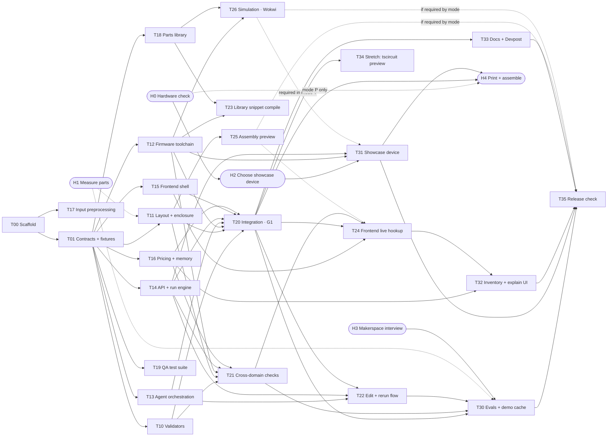

# Build plan: Prompt-to-Device (Claude Code handoff)

This plan splits the HackPrinceton project into tasks that several Claude Code agents can build **in
parallel**, each in its own git worktree. Parallel work stays aligned through three mechanisms:

1. **Contracts first.** One agent (the Integrator) writes every shared interface, fixture and stub file
   before anyone else starts (Wave 0). After Gate G0 the contracts are frozen.
2. **Disjoint ownership.** Every file has exactly one owning task (see `CLAUDE.md`), so branches never
   edit the same file and merges don't conflict.
3. **Producer–consumer review.** Every task is reviewed by a dedicated Reviewer agent *and* signed off
   by the agent that consumes its output. QA writes integration tests from the contracts while the
   features are being built.

Read `CLAUDE.md` first (every agent loads it automatically). The technical design (schema, parts
library, checks, starter code) is in `docs/PROJECT_PLAN.md`.

**Files in this handoff and where they go in the repo:** `CLAUDE.md` → repo root;
`handoff/` → `handoff/`; `docs/PROJECT_PLAN.md` → `docs/`; `scripts/setup_worktrees.sh` → `scripts/`.
T00 commits them on `main` before anything else.

---

## 0. Hardware availability (decide by hour 2)

We don't yet know whether we'll have **electronics parts** or a **3D printer** at the event. The product
itself (prompt → verified design files) needs neither, so **no agent task's acceptance criteria depend
on hardware**. Hardware affects only the showcase device, the demo, and how strongly we can pitch the
Hardware and Physical AI tracks. Every step that touches hardware has a fallback below, so none is left
orphaned whichever way it goes.

**H0 (humans, by hour 2):** confirm both, then fill in `handoff/HARDWARE.md` (`HAS_PARTS`, `HAS_PRINTER`,
`PRINTER_MODEL`, `MODE`). Agents read that file; nothing else changes in the code except which demo path
we rehearse. If the answer changes later (a printer frees up at hour 20), update the file and switch modes:
every mode uses the same code.

**Reduce the risk before the event:** bring our own parts kit (every part in the library, two spare
boards), which makes `HAS_PARTS` true regardless of the venue. For printing, ask the organizers, the
campus makerspace (the same contact as H3), or a teammate with a printer nearby, if the rules allow.

| Mode | Parts | Printer | Showcase in the demo | What changes |
| --- | --- | --- | --- | --- |
| **P** Full | yes | yes | Printed, assembled device running live | The plan as written |
| **E** Electronics only | yes | no | Device on a breadboard or perfboard, beside the 3D assembly preview; print files exported | H4 skipped; T25 assembly preview becomes required |
| **V** Virtual | no | yes or no | Showcase firmware running in the Wokwi simulator, beside the 3D assembly preview | H1 uses datasheet dimensions; T25 and T26 become required; T31 is accepted in simulation; H4 skipped, or print the empty enclosure as a prop if a printer exists |

**Every hardware-dependent step and its fallback**

| Step | P (full) | E (no printer) | V (no parts) |
| --- | --- | --- | --- |
| H1 measure parts | Calipers; `dims_source: measured` | Calipers | Datasheet or vendor drawing dimensions; `dims_source: datasheet`; UI labels them "verify before printing" |
| H2 choose showcase device | Library parts that **also have a `wokwi_type`** (so switching to V later doesn't force a new choice) | Same | Same; it must run in Wokwi |
| T11 printer check | Profile for the confirmed printer | Profile for the printer we'd print on later, else `generic` | `generic` |
| T25 assembly preview | Recommended | **Required** (demo centrepiece) | **Required** |
| T26 simulation | Stretch | Recommended | **Required** |
| T31 acceptance | Works on the bench and in the printed enclosure | Works on the bench | Runs in Wokwi: boots, reaches the relay, shows the result |
| H4 print and assemble | Start by hour 24 | Skipped; STL/STEP in the Devpost and README | Skipped (optional: print the empty enclosure as a prop) |
| G2 hardware check | Print started | Device works on the bench | Showcase simulation passes |
| Demo reveal | Hold up the device | Breadboard device + 3D assembly | Simulator + 3D assembly |
| Tracks | Hardware, Physical AI, Amazon, deepagents | Same (hardware exists) | Ask the Hardware and Physical AI sponsors whether a simulated build counts; if not, lead with Amazon, deepagents, Education |

---

## 1. Timeline and gates

| Wave | Hours | Runs in parallel | Ends with |
| --- | --- | --- | --- |
| 0: Foundation | 0–4 | 1 agent (Integrator) on `main` | **G0**: contracts frozen, stubs and fixtures merged, worktrees created |
| 1: Build the parts | 4–14 | up to 10 builders + QA + Reviewer | Each tool works on fixtures; merged one by one |
| 2: Integrate | 14–24 | 5 agents | **G1 (hour 18)**: plant monitor end to end from the UI. **G2 (hour 24)**: edits and cross-checks work |
| 3: Harden the demo | 24–32 | 5 agents + humans | **G3 (hour 32)**: feature freeze, eval pass rate met, demo cached |
| Release | 32–35 | Reviewer + Integrator | Tagged `v1.0-demo`, Devpost submitted |

**Gate checks**

- **G0** (Integrator, by hour 4): `make lint test` green on `main`; contract tests pass; every stub
  tool returns a `ToolResult`; `P2D_RUNNER=fake make dev` streams the fixture run into a bare page;
  `scripts/setup_worktrees.sh wave1` done.
- **G1** (hour 18): QA's `tests/e2e/test_plant_monitor.py` passes with real tools and a live model at
  least once; every UI tab is filled from a real run.
- **G2** (hour 24): `tests/e2e/test_edits.py` passes ("change wall thickness" reruns only layout,
  enclosure and assembly; "add a buzzer" passes every check); cross-checks green; showcase firmware
  compiles; plus the hardware check for our mode (section 0): **P** print started, **E** device works on
  the bench, **V** showcase simulation passes.
- **G3** (hour 32): each example prompt passes all checks in at least 4 of 5 eval runs; cached demo
  runs recorded; README done; no open "request changes" reviews.

---

## 2. Dependency graph

Solid arrows: the task can't start (or can't finish its acceptance tests) until the source is merged.
Dotted arrows: improves accuracy but doesn't block.



H0 decides which of the dotted "mode" edges apply (section 0).

**Critical path:** T00 → T01 → (T11 or T13, the longest Wave 1 tasks) → T20 → T22 → T30 → T35.
Put your fastest agents and closest human attention on T13, T11 and T20.

---

## 3. Agents, worktrees and who supervises them

| Agent | Tasks, in order | Worktree | Branches | Human |
| --- | --- | --- | --- | --- |
| **I** Integrator | T00, T01, then merges, contract changes, T20 | main checkout | `main` | Person A |
| **B-validate** | T10 → T21 | `../<repo>-T10-validators` | `feat/T10-validators`, `feat/T21-cross-checks` | Person A |
| **B-agent** | T13 → T33 | `../<repo>-T13-agent` | `feat/T13-agent`, `feat/T33-docs` | Person A |
| **B-cad** | T11 → T25 → T34 | `../<repo>-T11-cad` | `feat/T11-cad`, `feat/T25-assembly`, `feat/T34-tscircuit` | Person B |
| **B-parts** | T18 → T26 | `../<repo>-T18-parts` | `feat/T18-parts`, `feat/T26-simulation` | Person B |
| **B-fw** | T12 → T23 → T31 | `../<repo>-T12-firmware` | `feat/T12-firmware`, … | Person C |
| **B-api** | T14 → T22 | `../<repo>-T14-api` | `feat/T14-api`, `feat/T22-edits` | Person C |
| **B-web** | T15 → T24 → T32 | `../<repo>-T15-web` | `feat/T15-web`, … | Person D |
| **B-bom** | T16 → T17 | `../<repo>-T16-bom` | `feat/T16-bom`, `feat/T17-input` | Person D |
| **Q** QA | T19 → T30 | `../<repo>-T19-qa` | `feat/T19-qa`, `feat/T30-evals` | Person D |
| **R** Reviewer | Reviews every PR; T35 | `../<repo>-review` (detached) | none (read-only) | Rotating |

When an agent finishes a task, its human starts the next task in a **fresh worktree** from the latest
`main` (`scripts/setup_worktrees.sh add T21 cross-checks`), not in the old one. A fresh worktree and a
fresh session keep context small and make sure the agent builds on merged code.

**Running fewer agents at once?** Start Wave 1 tasks in this priority order and add more as slots free
up: T13, T11, T14, T12, T10, T15, T19, T16, T18, T17. Keep R running throughout: unreviewed PRs are
the usual bottleneck by hour 14.

---

## 4. Task summary

| ID | Task | Wave | Depends on | Agent | Reviewer | Consumer sign-off | Tests the card requires | Est. |
| --- | --- | --- | --- | --- | --- | --- | --- | --- |
| T00 | Repo scaffold and tooling | 0 | — | I | R + human | all | `make lint test` runs | 1 h |
| T01 | Contracts, stubs, fixtures | 0 | T00 | I | R + human | all | Contract tests | 2–3 h |
| T10 | Spec validators | 1 | T01 | B-validate | R | B-agent | Unit, one per error code | 3 h |
| T11 | Layout and enclosure | 1 | T01 (H1 dotted) | B-cad | R | B-web, B-validate | Unit + slow builds | 5 h |
| T12 | Firmware toolchain | 1 | T01 | B-fw | R | B-agent | Unit + slow compiles | 4 h |
| T13 | Agent orchestration | 1 | T01 | B-agent | R | B-api | Unit with fake tools + live smoke | 6 h |
| T14 | API and run engine | 1 | T01 | B-api | R | B-web | Unit + async API tests | 4 h |
| T15 | Frontend shell | 1 | T01 | B-web | R | B-api | Vitest reducer + component | 6 h |
| T16 | Pricing and memory | 1 | T01 | B-bom | R | B-web, B-agent | Unit with mocked HTTP | 3 h |
| T17 | Input preprocessing | 1 | T00 | B-bom | R | B-agent | Unit + slow ffmpeg | 2 h |
| T18 | Parts library expansion | 1 | T01 | B-parts | R + human spot-check | B-fw | Loader validation | 4 h |
| T19 | QA test suite (test-first) | 1 | T01 | Q | R | I | Integration + e2e (xfail until G1) | ongoing |
| T20 | Integration | 2 | T10–T16 | I | R | Q | Unxfail e2e | 3–4 h |
| T21 | Cross-domain checks | 2 | T10, T11, T12, T14, T16 | B-validate | R | B-web | Unit on fixture runs | 3 h |
| T22 | Edit and rerun flow | 2 | T13, T14, T20 | B-api | R | B-web, Q | Unit + e2e edits | 4 h |
| T23 | Library snippet compile | 2 | T12, T18 | B-fw | R | B-parts | Slow compile per part | 2 h |
| T24 | Frontend live hookup | 2 | T15, T20, T21 (T25 dotted) | B-web | R | Q | Vitest + manual run | 4 h |
| T25 | Assembly preview | 2 | T11 | B-cad | R | B-web | Unit on scene contents | 2–3 h |
| T26 | Simulation (Wokwi) | 2 | T12, T18 | B-parts | R | B-fw | Unit on diagram + live sim | 3–4 h |
| T30 | Evals and demo cache | 3 | T20, T21, T22, H3 | Q | R | I | Eval report | 4 h |
| T31 | Showcase device (placeholder) | 3 | H2, T12, T14 (T26 in mode V) | B-fw | R | I | Slow compile + mode check (section 0) | 4–6 h |
| T32 | Inventory and explain UI | 3 | T16, T24 | B-web | R | Q | Vitest | 3 h |
| T33 | Docs and Devpost | 3 | T20 | B-agent | R + human | humans | Links and commands work | 2 h |
| T34 | Stretch: tscircuit board preview | 3 | T20 | B-cad | R | B-web | Per card | opt. |
| T35 | Release check | Release | T30–T33 (T25, T26 if the mode requires them) | R | human | — | Full suite | 1–2 h |

**Human tasks** (not for agents)

| ID | Task | By hour | Unblocks |
| --- | --- | --- | --- |
| H0 | Confirm parts and printer access; fill in `handoff/HARDWARE.md` | 2 | H2, H4, which of T25/T26 are required |
| H1 | Mode P/E: measure every library part with calipers. Mode V: copy dimensions from datasheets or vendor drawings. Either way, record `dims_source` | 12 | Enclosure accuracy (T11), print (H4) |
| H2 | Choose the showcase device: library parts that all have a `wokwi_type`, calls an AI model through our backend, working by hour 28 | 4 | T31 |
| H3 | Makerspace/club interview; write example prompt 3; collect Peri evidence (also ask about printer access) | 24 | T30 prompt 3 |
| H4 | Mode P only: book printer; print and assemble the showcase enclosure | 24 start | Demo |
| H5 | Approve merges at each gate; answer agents' contract requests within 30 min | always | everything |

---

## 5. Task cards

Every card lists the paths it owns. Anything not listed belongs to someone else.

### T00 · Repo scaffold and tooling

- **Agent:** I · **Wave:** 0 · **Branch:** `main` · **Blocks:** everything
- **Owns:** repo root files, `pyproject.toml`, `Makefile`, `.gitignore`, `frontend/` skeleton, CI config,
  `scripts/setup_worktrees.sh`, `handoff/` folders.
- **Build:**
  - `uv` project, Python 3.12+ (the sponsor's deepagents workshop requires 3.12). Dependencies: `fastapi`, `uvicorn[standard]`, `pydantic>=2`, `pyyaml`,
    `jinja2`, `httpx`, `build123d`, `trimesh`, `deepagents`, `langchain-anthropic` (or the provider you
    choose), `python-multipart`, `sse-starlette`. Dev: `pytest`, `pytest-asyncio`, `respx`, `ruff`.
  - `pytest` markers `slow` and `live` registered in `pyproject.toml`; `make test` runs
    `pytest -m "not slow and not live"`.
  - `frontend/`: Vite React-TS template plus `three`, `@react-three/fiber`, `@react-three/drei`, `vitest`,
    `@testing-library/react`, `json-schema-to-typescript` (dev).
  - `Makefile` targets from `CLAUDE.md`; `-include .env.worktree` so ports differ per worktree.
  - `.gitignore`: `.venv`, `node_modules`, `runs/`, `.env`, `.env.worktree`, `.pio`, `*.stl` outside `fixtures/`.
  - Empty package folders with `__init__.py` for every path in the ownership map.
  - Optional CI (GitHub Actions): `make lint test` on every PR.
- **Acceptance:** fresh clone → `make setup && make lint test` passes (zero tests is fine); `npm run build` passes.

### T01 · Contracts, stubs and fixtures

- **Agent:** I · **Wave:** 0 · **Branch:** `main` · **Depends on:** T00 · **Blocks:** all of Wave 1
- **Owns:** `backend/contracts/`, `backend/tools/toolbox.py`, `backend/tools/fakes.py`, stub versions of
  every tool module, `backend/app/main.py` + router stubs, `fixtures/` (plus an empty `fixtures/firmware/`
  for T12), `frontend/src/contracts/`, `tests/contract/`, the 5 plant-monitor part files,
  `handoff/status/*.md` (one per task from `_TEMPLATE.md`, state "not started"), `handoff/MERGES.md`.
- **Build:**
  1. `backend/contracts/spec.py`: the models from `docs/PROJECT_PLAN.md`, plus `rev: int = 0` on `ProjectSpec`,
     and `Placement(ref, x_mm, y_mm, rot_deg, against_wall: Literal[...] | None)` and
     `Layout(placements, cavity_mm: tuple[float, float, float])`.
  2. `backend/contracts/parts.py`: `PartDef` (fields from the parts-library table in `docs/PROJECT_PLAN.md`, plus
     `provisional: bool`, `dims_source: Literal["measured", "datasheet", "listing"]`, `source: str` for the
     datasheet URL, and `wokwi_type: str | None` for simulation), `BoardDef(PartDef)` (adds `wokwi_board:
     str | None`), `PartLibrary`. Printer profiles: `backend/parts/printers/generic.yaml` with a conservative
     build volume, used until H0 names a printer.
  3. `backend/contracts/results.py`, `events.py`, `runner.py` as summarized in `CLAUDE.md`. Event stages
     include `assembly` and `simulate`; the runtime skips stages that `handoff/HARDWARE.md`'s mode doesn't need.
  4. `backend/contracts/tools.py`: one `Protocol` per tool, and `ToolBox` (a dataclass holding them).
     Signatures (all return `ToolResult`; as built at G0, `backend/contracts/tools.py` is authoritative):
     ```python
     validate_spec(spec, lib)
     compute_layout(spec, lib, out_dir)              # artifacts: layout_json; data["layout"] = Layout
     build_enclosure(spec, layout, lib, out_dir)     # artifacts: base_stl, base_step, lid_stl, lid_step, manifest
     check_enclosure(spec, layout, lib, out_dir, printer_id)
     write_firmware_project(spec, lib, main_cpp, out_dir)  # artifacts: platformio_ini, pins_h, main_cpp
     lint_firmware(project_dir)
     compile_firmware(project_dir)
     build_wiring(spec, lib, out_dir)                # artifacts: wiring_json (T14, backend/runtime/wiring.py)
     price_bom(spec, lib, prices, owned, out_dir)    # artifacts: bom_json; data: Bom
     preprocess_input(paths, out_dir)                # data: images, transcript
     cross_checks(run_dir, spec, lib)
     build_assembly(spec, layout, lib, out_dir)      # artifacts: assembly_glb
     build_simulation(spec, lib, project_dir, out_dir)  # artifacts: diagram_json, wokwi_toml
     run_simulation(sim_dir, timeout_ms, expect_text)   # artifacts: serial_log, screenshot
     ```
  5. Stub modules at the owners' paths (`backend/tools/validate_spec.py`, `layout.py`,
     `build_enclosure.py`, `check_enclosure.py`, `firmware.py`, `pricing.py`, `preprocess_input.py`,
     `cross_checks.py`, `backend/cad/assembly.py`, `simulation.py`): correct signatures, each returning
     `ToolResult(ok=False, errors=[ToolError(code="not_implemented", ...)])`.
  6. `backend/tools/toolbox.py`: `real_toolbox()` (imports the functions above, so it becomes real as
     each module merges) and `backend/tools/fakes.py`: `fake_toolbox()` returning fixture-based success.
  7. `backend/app/main.py` creating the FastAPI app and including routers `runs`, `files`, `memory`,
     `device` (each a stub `APIRouter` in its own file), so later tasks never edit `main.py` to add routes.
  8. Fixtures:
     - `fixtures/specs/plant_monitor.json` (valid) and one invalid spec per validator error code
       (`pin_conflict`, `reserved_pin`, `input_only_output`, `i2c_address_conflict`, `voltage_mismatch`,
       `unconnected_pin`, `unknown_part`).
     - `fixtures/events/plant_monitor.jsonl`: a complete hand-written run (every stage, one failure then
       a retry pass) referencing the files below.
     - `fixtures/runs/plant_monitor/`: placeholder `base.stl` (a simple box), `main.cpp`, `pins.h`,
       `platformio.ini`, `bom.json` with prices marked `"FAKE"`.
  9. Parts: `esp32_devkitc` (board), `bme280_breakout`, `ssd1306_096_i2c`, `soil_moisture_capacitive`,
     `buzzer_passive`. Pinouts from datasheets with `source:` URLs; dimensions `provisional: true`,
     `dims_source: datasheet`; `wokwi_type` filled where Wokwi has the part (check its parts list).
  9b. `handoff/HARDWARE.md` from the template in this handoff (humans fill it in at H0).
  10. `make types`: export JSON Schema from the Pydantic models and generate `frontend/src/contracts/*.ts`.
  11. Contract tests (`tests/contract/`): fixtures validate; library loads; every tool in
      `real_toolbox()` is callable and returns a `ToolResult`; the event fixture parses line by line.
- **Acceptance:** the G0 checks above.
- **Review:** R plus a human reads every contract file before the freeze. This is the most expensive
  place to get something wrong.

### T10 · Spec validators

- **Agent:** B-validate · **Depends on:** T01 · **Blocks:** T20, T21
- **Owns:** `backend/tools/validate_spec.py`, `tests/unit/validate/`
- **Build:** `validate_spec(spec, lib)` covering: Pydantic shape (re-validate), unknown part IDs,
  GPIO used twice (I2C SDA/SCL and SPI buses may share), board `reserved_pins`, outputs on
  `input_only_pins`, outputs on `strapping_pins` (warning), analog reads on `adc2_pins` when
  `firmware.needs_wifi`, unconnected part pins, duplicate I2C addresses (respecting alternative
  addresses), 5 V logic on a 3.3 V pin, total `max_current_ma` above the board's budget.
  Every error lists free alternatives where possible ("free output pins: …").
- **Acceptance:**
  - [ ] Plant-monitor fixture passes with zero errors.
  - [ ] Each invalid fixture fails with exactly its error code.
  - [ ] All board facts come from the board YAML, none hard-coded.
- **Tests:** one unit test per error code; one test that the messages name the pin and part.
- **Consumer sign-off (B-agent):** reads three error messages and confirms the parts sub-agent could fix
  the spec from the message alone.

### T11 · Layout and enclosure

- **Agent:** B-cad · **Depends on:** T01 (H1 improves accuracy) · **Blocks:** T20, T21
- **Owns:** `backend/tools/layout.py`, `backend/tools/build_enclosure.py`,
  `backend/tools/check_enclosure.py`, `backend/cad/`, `backend/parts/printers/`, `tests/unit/cad/`
- **Build:**
  - `compute_layout`: deterministic. Parts whose `features` face a wall are placed against that wall
    first; the rest are packed in rows with `clearance_mm` gaps; returns `Layout` with the cavity size
    (largest extents + clearance; height = tallest part + standoff + clearance).
  - `build_enclosure`: the `box_lid` template from `docs/PROJECT_PLAN.md`, extended with a lid lip and corner screw
    holes; cutouts placed from each part's `features` and placement; exports STEP and STL for base and
    lid plus `manifest.json` (which cutout serves which part feature).
  - `check_enclosure`: `trimesh` watertight check for each STL, fits the printer's build volume
    (`backend/parts/printers/<id>.yaml`, verify the numbers from the vendor page and cite `source:`;
    use `generic` until `handoff/HARDWARE.md` names a printer), walls ≥ `wall_mm`, placements inside
    the cavity with no overlaps.
  - Works the same with `provisional` dimensions; `manifest.json` records whether any part's
    `dims_source` isn't `measured`, so the UI can say "verify before printing".
- **Acceptance:**
  - [ ] Same spec gives byte-identical `manifest.json` and layout JSON on two runs.
  - [ ] Plant-monitor build is watertight and fits the printer.
  - [ ] Swapping `ssd1306_096_i2c` for a larger display grows the cavity and moves the window cutout.
- **Tests:** layout unit tests (no overlaps, wall-facing features touch their wall, determinism);
  slow tests building the plant monitor and the swap case; a golden layout snapshot.
- **Consumer sign-off:** B-web loads the STL in the viewer; B-validate confirms `manifest.json` is
  enough for T21's cutout check.

### T12 · Firmware toolchain

- **Agent:** B-fw · **Depends on:** T01 · **Blocks:** T13's live smoke, T20, T23, T31
- **Owns:** `backend/tools/firmware.py`, `firmware_templates/`, `fixtures/firmware/` (T01 creates the
  empty folder), `tests/unit/firmware/`
- **Build:**
  - `pins_header(spec)`: `#define PIN_<REF>_<PIN> <n>` for every GPIO connection; sorted, no timestamps.
  - `write_firmware_project`: renders `platformio.ini` from the board's `pio_board` and the union of the
    parts' `pio_lib_deps`; writes `include/pins.h` and `src/main.cpp`.
  - `lint_firmware`: `main.cpp` must include `pins.h`; no numeric literals as the pin argument of
    `pinMode`, `digitalWrite`, `digitalRead`, `analogRead`, `Wire.begin`, `ledcAttachPin`.
  - `compile_firmware`: `pio run -d <dir>` with a timeout; parse `file:line:col: error: msg` lines into
    `ToolError`s; return the last 40 log lines in `log`.
  - A known-good `fixtures/firmware/plant_monitor_main.cpp`.
  - Convention for every generated firmware: print `P2D_READY` on serial at the end of `setup()`.
    `lint_firmware` checks for it; T26's simulation waits for it.
- **Acceptance:**
  - [ ] Golden plant monitor compiles.
  - [ ] A file with a syntax error returns parsed errors with line numbers.
  - [ ] Lint rejects `digitalWrite(4, HIGH)` and accepts `digitalWrite(PIN_BUZZER1_SIG, HIGH)`.
- **Tests:** unit tests for the header, ini rendering and lint; slow compile tests.
- **Note:** run one compile per board during setup so PlatformIO downloads toolchains before
  parallel compiles start.
- **Consumer sign-off (B-agent):** compile errors are specific enough for the firmware sub-agent to fix.

### T13 · Agent orchestration

- **Agent:** B-agent · **Depends on:** T01 · **Blocks:** T20, T22
- **Owns:** `backend/agent/` (orchestrator, sub-agents, prompts, tool wrappers, `request_change`),
  `tests/unit/agent/`
- **Build:** (read "Using deepagents" in `docs/PROJECT_PLAN.md` first)
  - First, check the installed `deepagents` version's API (argument names have changed between versions;
    planning became opt-in in v0.7) and note the version in your status file.
  - Implement the `Runner` protocol: `AgentRunner(toolbox, model)` with `run()` and `edit()`.
  - Orchestrator via `create_deep_agent(...)` with three custom sub-agents (parts-and-pins, firmware,
    enclosure). Restrict or disable the default `general-purpose` sub-agent if the version allows, so the
    orchestrator can't route around the specialists. A per-sub-agent `model` lets the parts agent use a
    stronger model than the others.
  - **Planning:** enable the `write_todos` planning tool (`TodoListMiddleware` in recent versions) and
    forward each todo-list update as a `plan` event, so the UI shows the agent's live plan.
  - **Filesystem:** the agent's built-in file tools are a **scratchpad only** (in-memory state backend).
    Real artifacts (`spec.json`, `main.cpp`, CAD files) are written only by our validated tools, so
    nothing unchecked reaches the run folder.
  - **Parallel work:** firmware and enclosure sub-agents run in parallel once the spec validates (async
    sub-agents if the version supports them; otherwise two concurrent calls from the runner).
  - **Threads:** use a LangGraph checkpointer with `thread_id = run_id`, so `edit()` continues the same
    conversation with full history.
  - **Questions to the user:** use `interrupt_on` (human-in-the-loop) for at most two clarifying
    questions and for approving an over-budget BOM; surface them as `question` events. If nobody answers
    within the configured timeout, the agent states its assumption and continues.
  - **House rules:** put the fixed rules (library parts only, `PIN_*` macros, `P2D_READY` line,
    `request_change` for cross-domain changes) in an `AGENTS.md` passed through `memory`, and keep
    role-specific instructions in each sub-agent's prompt.
  - Wrap each `ToolBox` function as an agent tool. Wrappers emit `Event`s automatically (running, then
    passed or failed) and **enforce the 3-retry limit in code**, not only in the prompt.
  - `write_spec(json)`: validates against `ProjectSpec`, bumps `rev`, saves `spec.json`.
  - `request_change(field, reason, options)`: the only way a sub-agent asks for a change outside its
    section; it returns to the orchestrator.
  - Prompts in `backend/agent/prompts/*.md`: orchestrator, parts-and-pins (must choose only library
    parts and give a `reason` for each part and pin), firmware (must use `PIN_*` macros and print
    `P2D_READY`), enclosure (chooses parameters and extras; never edits geometry code from the template).
- **Acceptance:**
  - [ ] With `fake_toolbox()`, a run emits events for every stage in order (including `plan` events)
        and returns a valid spec.
  - [ ] An `edit()` on the same `run_id` sees the earlier conversation.
  - [ ] A tool that fails 4 times ends the stage as `failed` after exactly 3 retries.
  - [ ] `make test-live` smoke: the plant-monitor prompt with a real model and fake tools yields a spec that passes T10 (once T10 merges).
- **Tests:** unit tests with fake tools and a scripted fake model if the framework supports one;
  otherwise test the wrappers and retry logic directly. One `live` smoke test.
- **Consumer sign-off (B-api):** `AgentRunner` drops into the API's runner slot without changes.

### T14 · API and run engine

- **Agent:** B-api · **Depends on:** T01 · **Blocks:** T15 (live), T20, T22, T31
- **Owns:** `backend/app/main.py`, `backend/app/routers/runs.py`, `backend/app/routers/files.py`,
  `backend/runtime/` (`runs.py`, `deps.py`, `replay_runner.py`, `wiring.py`), `tests/unit/api/`
- **Build:**
  - `POST /runs` (multipart: prompt, files, `user_context` JSON) → `run_id`; runs the configured runner
    in a background task.
  - `GET /runs/{id}/events`: server-sent events; supports `Last-Event-ID` to replay from a sequence number.
  - `GET /runs/{id}/spec`, `GET /runs/{id}/files/{path}` (reject path traversal).
  - `POST /runs/{id}/edit` → calls `runner.edit()` (full flow in T22).
  - Run directory: `runs/<id>/{spec.json, events.jsonl, manifest.json, firmware/, cad/, bom.json, wiring.json}`.
    `manifest.json` records the `spec_rev` each artifact was built from.
  - `deps.py`: `DEPENDS_ON`, `ORDER`, `stages_to_rerun()` from `docs/PROJECT_PLAN.md`.
  - `wiring.py`: builds `wiring.json` (connections enriched with library pin labels) for the wiring tab.
  - `ReplayRunner`: replays any recorded run directory (the fixture run by default) with realistic
    delays. `P2D_RUNNER=fake|replay:<run_dir>|real`.
- **Acceptance:**
  - [ ] Frontend can develop against `P2D_RUNNER=fake` with no API keys.
  - [ ] Reconnecting with `Last-Event-ID` resumes without duplicates.
  - [ ] `stages_to_rerun({"parts"})` returns every stage; `{"enclosure"}` returns layout, enclosure and assembly.
  - [ ] Stages the mode in `handoff/HARDWARE.md` doesn't need (e.g. `simulate` in mode P), and tools
        that return `not_implemented` or lack a token, are emitted as `skipped`, never left pending or failed.
- **Tests:** `deps.py` unit tests; async API tests with `httpx.AsyncClient` and the replay runner;
  a path-traversal test.
- **Consumer sign-off (B-web):** event stream and file URLs work in the UI.

### T15 · Frontend shell

- **Agent:** B-web · **Depends on:** T01 · **Blocks:** T20, T24
- **Owns:** `frontend/` except `src/contracts/`
- **Build:** chat panel with prompt box and file upload (image, video); right side tabs: 3D (STL via
  `STLLoader`, orbit controls), Wiring (table from `wiring.json`), BOM (lines, owned parts marked, total
  vs budget), Code (`main.cpp`, `pins.h`, `platformio.ini`, read-only); a checks panel visible on every
  tab. State comes from a pure reducer over `Event`s (keyed by stage; tracks `spec_rev`; marks
  artifacts stale when `manifest` rev < spec rev).
- **Acceptance:**
  - [ ] With `P2D_RUNNER=fake`, the fixture run fills every tab and the checks panel, including the
        failed-then-retried stage.
  - [ ] Refreshing the page mid-run resumes the stream.
- **Tests:** `vitest` reducer tests driven by `fixtures/events/plant_monitor.jsonl`; component smoke tests.
- **Consumer sign-off (B-api):** the UI uses only documented endpoints and event fields.

### T16 · Pricing and memory

- **Agent:** B-bom · **Depends on:** T01 · **Blocks:** T20, T21, T32
- **Owns:** `backend/tools/pricing.py`, `backend/memory/`, `backend/app/routers/memory.py`,
  `scripts/prefetch_prices.py`, `tests/unit/pricing/`, `tests/unit/memory/`
- **Build:**
  - Nexar client: OAuth client-credentials token, GraphQL query by MPN. Check the exact query and
    field names in Nexar's schema explorer before coding.
  - `prefetch_prices.py` writes `backend/parts/prices.json` with `fetched_at`; `price_bom()` uses
    quantity price breaks, falls back to cache, then to `manual_price_usd`; subtracts owned parts;
    flags over budget.
  - SQLite memory: inventory (part ID, quantity), preferences (budget, printer), rejections (free text);
    `GET/PUT /memory/...` endpoints in `routers/memory.py`.
- **Acceptance:**
  - [ ] With HTTP mocked to fail, `price_bom` still returns prices from cache or manual values.
  - [ ] Owned parts cost 0 and are labelled; `over_budget` is correct at the boundary.
- **Tests:** `respx`-mocked Nexar responses (success, 401, 429, timeout); memory CRUD.
- **Consumer sign-off:** B-web (BOM data shape), B-agent (memory API is enough to fill `UserContext`).

### T17 · Input preprocessing

- **Agent:** B-bom (after T16) · **Depends on:** T00 · **Blocks:** nothing critical
- **Owns:** `backend/tools/preprocess_input.py`, `tests/unit/input/`
- **Build:** images normalised (EXIF rotation, long edge capped to keep model costs down); video →
  up to 8 keyframes with `ffmpeg` plus a transcript (local Whisper or an API, set by env).
- **Acceptance:** a 10-second generated test video (`ffmpeg testsrc`) produces ≤ 8 frames and a transcript field.
- **Tests:** unit tests with transcription mocked; slow test running ffmpeg.

### T18 · Parts library expansion

- **Agent:** B-parts · **Depends on:** T01 · **Blocks:** T23; widens what prompts can ask for
- **Owns:** `backend/parts/library/*.yaml` (except T01's five), `backend/parts/snippets/`
- **Build:** the rest of the starter list from `docs/PROJECT_PLAN.md` (about 20 parts). For each: pinout,
  voltages, current, I2C addresses, `pio_lib_deps`, a minimal snippet using only `PIN_*` macros, `mpn`
  or a manual price and link, dimensions with `provisional: true` and `dims_source: datasheet`, a
  `source:` datasheet URL, and `wokwi_type` when Wokwi supports the part (check Wokwi's parts list;
  leave it empty rather than guess).
- **Acceptance:** every file loads in `PartLibrary`; every pin type is from the allowed set.
- **Review:** R plus a **human spot-check of 3 random parts against their datasheets**. Invented
  pinouts are the biggest risk in AI hardware design.
- **Consumer sign-off (B-fw):** snippets follow the macro convention (T23 compiles them).

### T19 · QA test suite (test-first)

- **Agent:** Q · **Depends on:** T01 · **Runs alongside all of Wave 1**
- **Owns:** `tests/integration/`, `tests/e2e/`, `evals/`
- **Build (from the contracts, not from anyone's implementation):**
  - Integration: plant-monitor spec through validate → layout → enclosure → firmware → BOM with
    `real_toolbox()`; each step `xfail` until its task merges.
  - E2E: `test_plant_monitor.py` (POST a run, read events to `done`, every check passed);
    `test_edits.py` (wall-thickness change reruns only layout, enclosure and assembly; "add a buzzer" passes every
    check; artifacts' `spec_rev` matches the spec).
  - Invariant helpers shared by both: `pins.h` ↔ `connections`, cutouts ↔ features, BOM ↔ parts.
  - `evals/run_evals.py` skeleton: runs `evals/prompts.yaml` N times and writes a pass-rate CSV.
- **Acceptance:** suite runs today with clear xfail reasons naming the task that will make each pass.
- **Consumer sign-off (I):** the suite is usable as the G1 and G2 gate checks.

### T20 · Integration (G1)

- **Agent:** I · **Depends on:** T10–T16 merged
- **Owns:** `backend/tools/toolbox.py`, glue fixes anywhere **only with the owner's agreement in their status file**
- **Build:** set `P2D_RUNNER=real` with `AgentRunner(real_toolbox())`; run the plant-monitor prompt
  from the UI; fix glue; remove xfail markers as tests pass (coordinate with Q).
- **Acceptance:** the G1 checks.

### T21 · Cross-domain checks

- **Agent:** B-validate · **Depends on:** T10, T11, T12, T14, T16
- **Owns:** `backend/tools/cross_checks.py`, `tests/unit/cross_checks/`
- **Build:** `cross_checks(run_dir, spec, lib)`: `pins.h` matches `connections`; every wall-facing
  feature has a cutout in the enclosure `manifest.json`; every placement sits inside the cavity; every BOM
  line maps to a part in the spec; every artifact's `spec_rev` equals `spec.rev` (otherwise
  `stale_artifact`). Reuse Q's invariant helpers if merged; don't duplicate them.
- **Acceptance:** green on a real plant-monitor run; each mismatch, injected into a copy of the run directory, is caught.
- **Consumer sign-off (B-web):** error codes map cleanly to rows in the checks panel.

### T22 · Edit and rerun flow

- **Agent:** B-api · **Depends on:** T13, T14, T20
- **Owns:** `backend/runtime/` (edit path), `backend/app/routers/runs.py` (edit endpoint), `tests/unit/api/`
- **Build:** `POST /runs/{id}/edit {instruction}` → `runner.edit()` patches the spec (rev + 1) →
  `stages_to_rerun(changed_fields)` → emit `stale` for affected stages → rerun. Deterministic stages
  (validate, layout, enclosure, assembly, wiring, simulate, BOM) rerun **without the model**. Firmware reruns without the
  model when only pins changed (regenerate `pins.h`, recompile); otherwise the firmware sub-agent runs.
  Then `cross_checks`.
- **Acceptance:** Q's `test_edits.py` passes; a wall-thickness edit makes no model calls.
- **Consumer sign-off:** B-web (stale → running → passed shows correctly), Q.

### T23 · Library snippet compile

- **Agent:** B-fw · **Depends on:** T12, T18
- **Owns:** `tests/unit/firmware/test_snippets.py`; after T18 merges, `backend/parts/snippets/` passes to B-fw for fixes
- **Build:** for each part, a generated project with the board plus that part's snippet; compile all (slow).
- **Acceptance:** every snippet compiles and passes `lint_firmware`.

### T24 · Frontend live hookup

- **Agent:** B-web · **Depends on:** T15, T20, T21
- **Owns:** `frontend/`
- **Build:** run against the real backend; error and retry states; stale badges from `spec_rev`; an
  edit box ("add a buzzer") wired to the edit endpoint; checks panel rows from `cross_checks` codes;
  the agent's live plan from `plan` events; answer boxes for `question` events; an "Assembly" toggle in
  the 3D tab that loads `assembly.glb` when T25 has merged (hidden otherwise); a "Simulation" panel
  with the serial log and screenshot when a `simulate` stage ran.
- **Acceptance:** the demo flow from `docs/PROJECT_PLAN.md` works start to finish in the browser.

### T25 · Assembly preview

- **Agent:** B-cad · **Wave:** 2 · **Depends on:** T11 · **Required in modes E and V**, recommended in P
- **Owns:** `backend/cad/assembly.py`, `tests/unit/assembly/`
- **Why:** without a printed device, this is how judges see the physical product. It's also useful in mode
  P to show what will go inside the case.
- **Build:** `build_assembly(spec, layout, lib, out_dir)` writes `assembly.glb` (a `trimesh` scene): the
  enclosure base, the lid raised above it (exploded view), and each part as a box of its `board_mm` at its
  `Placement`, named by its `ref` and coloured by category. Parts with non-measured dimensions get a
  flag in the node metadata so the UI can label them.
- **Acceptance:**
  - [ ] Plant-monitor `assembly.glb` loads in three.js's `GLTFLoader` with one node per part plus base and lid.
  - [ ] Every part box sits inside the cavity at its layout position (checked numerically, not by eye).
- **Tests:** unit tests on the scene graph (node names, positions vs layout); one slow test building the file.
- **Consumer sign-off (B-web):** the toggle in T24 renders it.

### T26 · Simulation (Wokwi)

- **Agent:** B-parts · **Wave:** 2 · **Depends on:** T12, T18 · **Required in mode V**, recommended in E,
  stretch in P
- **Owns:** `backend/tools/simulation.py`, `tests/unit/simulation/`
- **Build:**
  - `build_simulation`: generates Wokwi's `diagram.json` (board from `wokwi_board`, parts from each part's
    `wokwi_type`, wires from `spec.connections`) and `wokwi.toml` pointing at PlatformIO's build output.
    Parts without a `wokwi_type` are left out with a warning in the result.
  - `run_simulation`: runs `wokwi-cli` with a timeout, `--expect-text P2D_READY`, a serial log file and a
    screenshot; returns them as artifacts. Check flag names against the current Wokwi CLI docs.
  - Needs `WOKWI_CLI_TOKEN` in `.env` and internet access: the firmware is uploaded to Wokwi's servers
    for the simulation. Without a token, return a `skipped` result, not a failure.
- **Acceptance:**
  - [ ] Plant-monitor `diagram.json` has every part that has a `wokwi_type` and one wire per connection.
  - [ ] `make test-live`: the compiled plant monitor reaches `P2D_READY` in the simulator and returns a screenshot.
- **Tests:** unit tests on diagram generation (no network); one `live` test running the simulator.
- **Consumer sign-off (B-fw):** T31 can run the showcase firmware through it unchanged.

### T30 · Evals and demo cache

- **Agent:** Q · **Depends on:** T20, T21, T22, H3
- **Owns:** `evals/`, `tests/e2e/`
- **Build:** `evals/prompts.yaml` with the plant monitor, the assistive-device prompt and the makerspace
  prompt (from H3); 5 runs each; pass-rate report; record the best run of each to `evals/cache/` for
  `P2D_RUNNER=replay:<dir>`.
- **Acceptance:** G3's pass-rate bar met, or a short report of what fails and why for I and the humans to decide on.

### T31 · Showcase device (placeholder)

- **Agent:** B-fw · **Depends on:** H2 (device chosen), T12, T14; T26 in mode V
- **Owns:** `device/`, `backend/app/routers/device.py`
- **Build:** to be specified once H2 picks the device. Fixed requirements: library parts that all have a
  `wokwi_type`; the device calls the AI model **through our backend** (the relay router holds the API
  key); designed by running the tool itself (its spec, firmware and enclosure come from a real run);
  done by hour 28.
- **Acceptance** (the mode comes from `handoff/HARDWARE.md`; the first two items apply in every mode):
  - [ ] Firmware compiles and passes `lint_firmware`.
  - [ ] Relay endpoint tested with a recorded request.
  - [ ] Mode P: works on the bench, then inside the printed enclosure.
  - [ ] Mode E: works on the bench (breadboard or perfboard).
  - [ ] Mode V: runs in Wokwi through T26, reaches the relay and shows the result. The simulator runs on
        Wokwi's servers, so the relay needs a public URL (for example a tunnel); confirm this works on day 1.

### T32 · Inventory and explain UI

- **Agent:** B-web · **Depends on:** T16, T24
- **Owns:** `frontend/`
- **Build:** inventory panel and budget input (memory API); "why?" tooltips showing each part's and
  pin's `reason`; owned parts highlighted in the BOM.
- **Acceptance:** setting "I own a BME280, budget $20" changes the next run's BOM accordingly.

### T33 · Docs and Devpost

- **Agent:** B-agent · **Depends on:** T20
- **Owns:** `README.md`, `docs/`
- **Build:** README (what it does, target user, setup, example prompts, limits), `docs/ARCHITECTURE.md`
  (diagram and the alignment rules), Devpost draft with notes for the Physical AI, Amazon and deepagents tracks.
- **Acceptance:** a teammate follows the README on a clean machine to a running fake-runner demo.

### T34 · Stretch: tscircuit board preview

- **Agent:** B-cad, after T25. Render-only custom-board preview from the spec. Start only after G2, and
  drop at G3 if unfinished. (Wokwi simulation moved to T26 because mode V depends on it.)

### T35 · Release check

- **Agent:** R · **Depends on:** T30–T33, plus T25/T26 if the mode requires them
- **Build:** clean-checkout `make setup lint test test-slow`; one `test-live` e2e run; secrets scan of
  the full history (e.g. `gitleaks` if installed, otherwise grep for key prefixes); README walkthrough;
  rehearse the demo path for the mode in `handoff/HARDWARE.md` (section 0) **and** the cached-run
  fallback; tag `v1.0-demo`.

---

## 6. Review protocol

**Who:** R, a dedicated Claude Code session that never builds features, in its own detached worktree.
Fresh eyes catch what the builder can't. Plus the consumer named on each card.

**How R reviews a branch**

```bash
cd ../<repo>-review
git checkout --detach feat/T10-validators      # detached: the branch stays checked out in its own worktree
uv sync && make lint test                      # and make test-slow if the card lists slow tests
git diff --stat main...feat/T10-validators     # scope check
git diff main...feat/T10-validators
```

**Checklist**

1. **Scope:** only owned paths changed; no contract or fixture edits.
2. **Acceptance:** every criterion on the card has a test, and the tests pass on a clean checkout.
3. **Side effects:** tools write only inside `out_dir`; no network in unit tests; no global state.
4. **Errors:** expected failures return `ToolResult` with actionable messages; no bare `except`.
5. **Security:** no secrets; file endpoints reject path traversal; `subprocess` uses argument lists, never `shell=True` with user input.
6. **Hardware facts:** pins, voltages and addresses cite a datasheet or vendor page (`source:` in YAML or a comment).
7. **Determinism:** generated files contain no timestamps or random ordering.
8. **Readability:** clear names, small functions, comments where hardware behaviour isn't obvious.

**Verdict:** approve, or request changes as a numbered list. Post with `gh pr review` if the repo is on
GitHub. Without GitHub: write `handoff/reviews/<TASK>.md` in the `../<repo>-reviews` worktree (branch
`reviews`) and commit; builders read it with `git show reviews:handoff/reviews/<TASK>.md`.

**Consumer sign-off:** the consumer agent checks out the producer's branch the same way, runs its own
code or tests against it, and replies "consumer OK" or lists what breaks.

---

## 7. Testing strategy

| Layer | Written by | When it runs | Marker |
| --- | --- | --- | --- |
| Unit | Each builder, in `tests/unit/<area>/` | Every commit, every PR | none |
| Contract | I (T01) | Every PR | none |
| Integration | Q (T19), from contracts, before features exist | PRs touching tools; G1 | `slow` |
| End to end | Q (T19) | G1, G2, release | `slow`, `live` |
| Evals | Q (T30) | Wave 3, nightly-style batches | `live` |

- **Test-first integration:** Q's tests exist before the features and are `xfail` with the blocking task
  named in the reason. A task isn't done until the integration tests that name it pass.
- **Golden files** (layout snapshot, `pins.h`, plant-monitor firmware) change only with an
  `--update-golden` flag and R's approval in the PR.
- **Live tests cost money:** run `make test-live` at gates, not on every commit.

---

## 8. Merge protocol and staying aligned

1. Only I merges to `main`, after: rebased on `main`, `make lint test` green (and slow tests if listed),
   R approved, consumer OK.
2. Suggested Wave 1 merge order: leaf tools first (T10, T12, T16), then T11, T14, T13, T15, T18, T17.
   Q's suite merges early and often.
3. After each merge, I appends a line to `handoff/MERGES.md` (`<hour> <sha> <task> <one line>`).
   Builders rebase on `main` at their next stopping point, and always before opening a PR.
4. **Contract changes:** a builder writes `handoff/contract-requests/<TASK>-<slug>.md`. I decides within
   30 minutes. If accepted, I lands it on `main` as its own commit, bumps `CONTRACT_VERSION` in
   `backend/contracts/__init__.py`, notes it in `handoff/MERGES.md`, reruns `make types`, and tells the
   affected agents to rebase. Contract tests catch anyone left behind.
5. **Ownership transfer** (e.g. T23 fixing T18's snippets) is written on the card or in `MERGES.md`;
   never assumed.
6. **Blocked agent:** set the status file to `blocked`, name the task, and continue with anything in the
   card that doesn't depend on it (tests, fakes, docstrings). Humans check `handoff/status/` every hour.

---

## 9. Kickoff prompts

Paste into a new Claude Code session started inside the task's worktree.

**Builder**

```
You are the <AGENT> agent for task <TASK>, working in this git worktree.
1. Read CLAUDE.md, then the <TASK> card in handoff/BUILD_PLAN.md, then everything in backend/contracts/,
   then the sections of docs/PROJECT_PLAN.md your card refers to.
2. Set handoff/status/<TASK>.md to "in progress" and commit it.
3. Write a short plan in the status file, then build. Edit only the paths your card owns.
4. Write the tests the card asks for. Run `make lint test` (and `make test-slow` if listed) until green.
5. Rebase on main, set the status file to "in review" with exact test commands, then open a PR
   (`gh pr create --fill --base main`) or tell me it's ready.
If a contract looks wrong or you need a path you don't own, file a contract request and tell me; don't work around it silently.
```

**Reviewer**

```
You are the Reviewer (R). You never write feature code.
Read CLAUDE.md and section 6 of handoff/BUILD_PLAN.md. When I give you a branch, review it with the
commands and checklist in section 6, against that task's card, and post the verdict as described there.
```

**QA**

```
You are QA (Q) for task <T19 or T30>. Read CLAUDE.md, your card in handoff/BUILD_PLAN.md and backend/contracts/.
Write tests from the contracts and `docs/PROJECT_PLAN.md`, never from another agent's implementation.
Mark tests that can't pass yet as xfail with the blocking task ID in the reason.
```

**Integrator**

```
You are the Integrator (I). Read CLAUDE.md and all of handoff/BUILD_PLAN.md.
Do T00, then T01, and stop at Gate G0 for human review of the contracts.
After G0 you merge reviewed PRs in the order in section 8, handle contract requests, keep handoff/MERGES.md
current, and lead T20.
```
