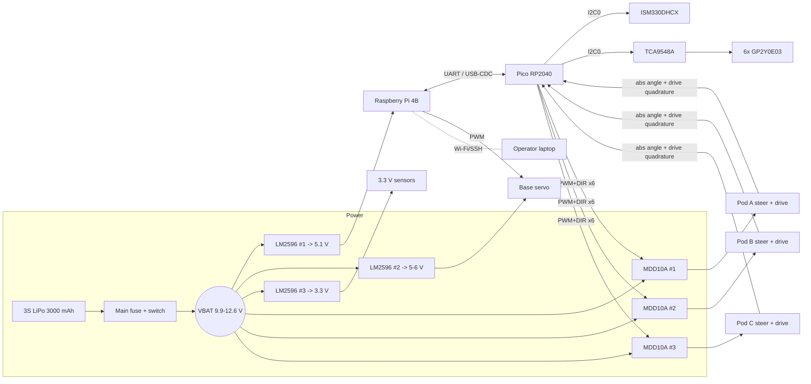
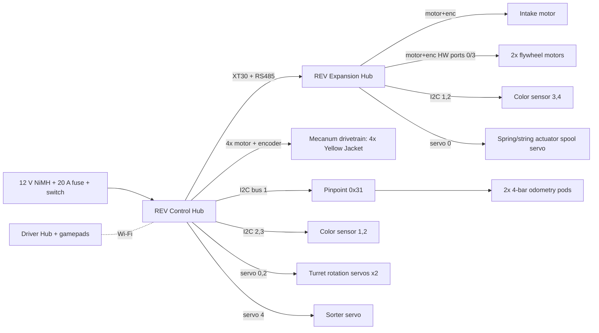
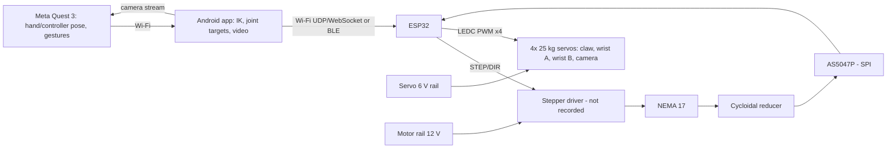
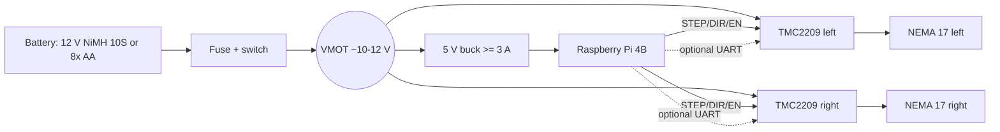
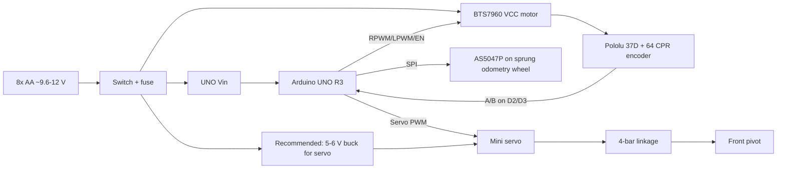

<!-- Single-file bundle of the robotics reference pack for agents with one-document context. -->


<!-- ===== README.md ===== -->

---
pack: robotics-reference-pack
version: 1.0
built: 2026-11-14
audience: AI agents (and humans) planning CAD, wiring and software for robots similar to these five builds
---

# Robotics reference pack

Five built robots, documented as structured reference designs. Each project file gives the architecture, bill of materials, power design, suggested pin map, CAD notes, software structure, lessons learned, open items and a verification checklist. A shared component library holds datasheet-derived specs and links for every part.

## Projects at a glance

| File | Robot | Compute pattern | Main / secondary compute | Drive / actuation | Key sensing | Power |
|---|---|---|---|---|---|---|
| `projects/01_three_pod_coaxial_swerve.md` | 3-pod coaxial swerve | SBC + real-time MCU | Raspberry Pi 4B / Pico RP2040 | 6x Pololu 37D, 3x MDD10A | ISM330DHCX IMU, 6x GP2Y0E03 via TCA9548A, 3x REV Through Bore V2, 3x Hall encoders | 3S LiPo 3000 mAh, 3x LM2596 (5 V Pi, 5 V servo, 3.3 V) |
| `projects/02_ftc_decode_robot.md` | FTC robot (2025-26 DECODE) | Vendor ecosystem | REV Control Hub / Expansion Hub / goBILDA Pinpoint | Mecanum, 7x Yellow Jacket, 4 servos; turret, sorter, string-driven actuator | 4x color sensors, 2x 4-bar dead wheels, 7 motor encoders | 12 V NiMH FTC battery |
| `projects/03_4dof_vr_teleop_arm.md` | 4-DOF arm, VR teleop | MCU + edge device | ESP32 / Android app + Meta Quest 3 | NEMA 17 cycloidal shoulder, 4x 25 kg servos (differential wrist, claw, camera) | AS5047P | not recorded (recommendations given) |
| `projects/04_stepper_differential_drive.md` | Open-loop diff drive | Single SBC | Raspberry Pi 4B | 2x NEMA 17, 2x TMC2209, idler | none | 12 V NiMH 10S **or** 8x AA (conflict flagged), 5 V buck |
| `projects/05_tripod_narrow_competition_vehicle.md` | Tripod narrow vehicle | Single 5 V MCU | Arduino UNO R3 | Pololu 37D + BTS7960, servo 4-bar steering | AS5047P sprung odometry wheel, motor encoder | 8x AA direct |

The arm is designed to mount on the swerve: the swerve's dedicated 5 V servo is the arm's base-yaw joint.

## How an agent should use this pack
1. Read `00_design_patterns.md` (compute patterns, power rules, logic levels, I2C addressing, CAD conventions, workflow).
2. Open the project closest to the new robot.
3. Fill `templates/project_spec_template.yaml` for the new design.
4. Pull parts and specs from `components/components.json` (machine-readable) or `components/component_library.md` (readable).
5. Follow the chosen project's verification checklist.

Single-context agents can load `ALL_IN_ONE.md`, which concatenates everything.

## What is fact vs. suggestion
- **Recorded by the builder**: compute choices, parts, roles, design rationale and lessons (e.g., two 5 V bucks so the Pi never browns out; two flywheel motors to limit speed fluctuations; motor sync in code for straight-line driving).
- **From datasheets** (checked 2026-11-14): numbers in `components.json`, with links.
- **Suggested by the pack**: pin maps, port allocations, protocols, software layouts and power recommendations. These are labeled "suggested" or "recommended" and are consistent with the datasheets, but are not the as-built wiring.
- **Flagged**: each project has an "Open items" list of facts not recorded (gear ratios, dimensions, servo models, link transports), and integration risks are called out where found (Pololu encoder voltage into a 3.3 V Pico, LM2596 headroom for the Pi 4B, UNO regulator powering a servo, power-source conflict on the diff drive).

## Datasheets
Datasheet PDFs are not bundled: the build environment could not download them. `datasheets/datasheet_index.md` lists every link, and

```
python3 datasheets/fetch_datasheets.py
```

downloads them into `datasheets/<component_id>/` on any machine with internet access (standard-library Python only).

## Layout
```
README.md                     this file
00_design_patterns.md         cross-project rules and formulas
projects/                     one reference design per robot
components/components.json    machine-readable part library (source of truth)
components/component_library.md  generated readable version
datasheets/datasheet_index.md every datasheet link
datasheets/fetch_datasheets.py   downloader
templates/project_spec_template.yaml
tools/build_docs.py           regenerates generated files
ALL_IN_ONE.md                 single-file bundle
```


<!-- ===== 00_design_patterns.md ===== -->

---
doc: design_patterns
purpose: Cross-project rules, formulas and checklists distilled from the five reference builds
read_before: any project file when planning a new robot
---

# Cross-project design patterns

These patterns recur across the five builds in `projects/`. Use them as defaults when planning a similar robot, and deviate only with a stated reason.

## 1. Compute architecture patterns

| Pattern | Used in | When to choose it | Split of responsibilities |
|---|---|---|---|
| **SBC + real-time MCU** | 3-pod swerve (Pi 4B + Pico) | Wireless/SSH, heavy compute or vision **and** tight control loops/many encoders | SBC: networking, UI, kinematics, odometry fusion, logging, high-level planning. MCU: PID loops (≥500 Hz), encoder decoding, sensor polling, local safety stops, watchdog. |
| **Single SBC, open loop** | Differential drive (Pi 4B) | Steppers with no feedback, low speed, compute-light | SBC does everything; motion timing must be offloaded (DMA waveforms or driver-side velocity mode) because Linux jitters. |
| **Single MCU + wireless edge device** | 4-DOF arm (ESP32 + Android + Quest 3) | Human-in-the-loop teleoperation; heavy math on a phone/headset | Edge device: tracking, IK, video. MCU: actuator timing, encoder reads, joint limits, link-loss failsafe. |
| **Single 5 V MCU** | Tripod vehicle (Arduino UNO) | Simple, few actuators, battery voltage within the board's Vin range | MCU does sensing, control and actuation; keep loops simple and fixed-rate. |
| **Vendor ecosystem controller** | FTC robot (REV Control Hub + Expansion Hub + Pinpoint) | Competition rules require it, or speed of development beats flexibility | Hub runs the SDK; coprocessors (Pinpoint) offload high-rate sensing. |

Rule of thumb: if a loop needs < 2 ms jitter, it does not belong on Linux.

## 2. Power architecture patterns

1. **Separate rails per noisy load.** The swerve uses one 5 V buck for the Pi and a second 5 V buck for the servo so servo current spikes never brown out the Pi. Apply the same rule to any SBC + servo/motor system.
2. **Motors run straight from the battery** through the driver; logic gets regulated rails.
3. **Budget at stall, not at running current.** Sum stall currents of everything that can stall at once; size the fuse, battery C-rating, wire gauge and drivers to that.
4. **Bulk capacitance** (470-2200 µF, rated ≥1.5x battery voltage) at each motor driver input and at servo buses.
5. **Common ground** between every rail and every logic device; star the grounds at the battery/distribution point for high-current returns.
6. **Fuse + switch** directly after the battery.
7. **Low-voltage cutoff** for LiPo packs: monitor pack voltage with an ADC divider and stop motors at ~3.3 V/cell under load.

### Power budget worksheet (copy into every new project)

| Rail | Loads | Typical A | Peak/stall A | Source | Source rating | Margin |
|---|---|---|---|---|---|---|
| VBAT | motor drivers | | | battery | C x Ah | ≥1.5x peak |
| 5 V (SBC) | SBC + USB | | | buck #1 | | ≥1.3x |
| 5-6 V (servo) | servos | | | buck/BEC #2 | | ≥ (stall x n x 0.5) |
| 3.3 V | sensors | | | buck #3 or MCU LDO | | |

## 3. Logic-level compatibility table

| Device | Logic | Notes |
|---|---|---|
| Raspberry Pi 4B GPIO | 3.3 V | not 5 V tolerant |
| Raspberry Pi Pico / RP2040 | 3.3 V | not 5 V tolerant |
| ESP32 | 3.3 V | not 5 V tolerant; GPIO34-39 input only |
| Arduino UNO R3 | 5 V | 3.3 V outputs usually read as HIGH, but check thresholds |
| REV Hub I2C | 3.3 V | 5 V sensors need a level shifter |
| Pololu 37D encoder | = encoder Vcc (3.5-20 V) | **trap for 3.3 V MCUs** |
| goBILDA Yellow Jacket encoder | 3.3-5 V | follow supply |
| AS5047P | = VDD (3.3 V or 5 V mode) | |
| GP2Y0E03 I2C | = VIN(IO) | |
| MDD10A inputs | 3.3 V or 5 V | |
| TMC2209 | VIO 3.3-5 V | |

## 4. I2C address planning

1. List every device and its address before wiring.
2. Duplicates: (a) put them on separate buses (REV hubs have 4 buses each), (b) use a TCA9548A mux (swerve: 6x GP2Y0E03 at 0x40), (c) use an address-select pin, (d) last resort, permanent address programming (GP2Y0E03 E-Fuse).
3. Keep bus length short (< 30 cm at 400 kHz without buffers), twist SDA/SCL with GND, and confirm pull-ups exist exactly once per bus segment (2.2-4.7 kΩ to the bus voltage).

| Address (7-bit) | Device |
|---|---|
| 0x28/0x29 | BNO055 (REV hub internal IMU) |
| 0x31 | goBILDA Pinpoint |
| 0x40 | GP2Y0E03 (all units) |
| 0x52 | REV Color Sensor V3, REV 2m Distance Sensor |
| 0x6A/0x6B | ISM330DHCX |
| 0x70-0x77 | TCA9548A |

## 5. Sensing patterns

- **Absolute + incremental pairing.** Swerve pods use an absolute encoder (REV Through Bore) on the steering axis so the pod angle is known at power-up, plus a Hall quadrature encoder on the drive motor for velocity. Use absolute sensing on anything that must home without moving.
- **Dead-wheel odometry.** Un-driven, spring-loaded tracking wheels (FTC 4-bar pods; tripod's custom sprung wheel with AS5047P) avoid wheel-slip errors of driven wheels. Keep them spring-loaded, on the ground plane, and mounted rigidly in the direction of travel.
- **IMU fusion.** Heading from integrated gyro Z (bias-calibrated at rest) + translation from wheel or dead-wheel encoders is the default 2D localization. The Pinpoint does this in hardware at 1500 Hz.
- **Reactive safety sensors.** Short-range distance sensors (swerve's 6x GP2Y0E03) should be evaluated on the MCU in the control loop so a stop does not depend on Wi-Fi or Linux.

## 6. Actuator and driver selection

| Need | Default choice from these builds | Why |
|---|---|---|
| Brushed DC with encoder, ≤ 12 V, ≤ 5.5 A stall | Pololu 37D + Cytron MDD10A (dual 10 A) | Driver headroom ~2x stall-free continuous, 3.3 V logic |
| Single high-current brushed motor on 5 V MCU | BTS7960 module | 43 A limit, cheap; IC obsolete, consider BTN8982-based modules |
| Open-loop precise position/velocity | NEMA 17 + TMC2209 | quiet, 256 µsteps, UART config, VACTUAL velocity mode |
| High-torque joint without backlash | NEMA 17 + printed cycloidal reducer + AS5047P on output | low backlash, back-drivable-ish, open loop with encoder check |
| Light positional joints | 25 kg-cm digital servos on a dedicated 6 V rail | simple, self-contained |
| FTC | goBILDA Yellow Jacket + REV hubs | legal, documented, plug-and-play |

## 7. Software patterns

- **Fixed-rate loops**: MCU PID 500-1000 Hz; kinematics/odometry 100-200 Hz; telemetry 10-50 Hz.
- **Command link SBC→MCU**: framed binary packets (start byte, length, msg id, payload, CRC-16) over UART/USB-CDC; MCU watchdog stops motors if no valid packet for 100-250 ms.
- **State machines** for mechanisms (sorter, intake, shooter spin-up) rather than nested if/else.
- **Units**: SI internally (m, rad, s); convert at the edges.
- **Calibration constants** in one config file (wheel diameters, offsets, encoder zero offsets, PID gains), never hard-coded in logic.
- **Bring-up order**: power rails with no loads → logic boards → each sensor alone → each motor alone at low duty → closed loops one at a time → integration.

## 8. CAD conventions for agents

- Units mm; model every purchased part from vendor STEP files when available (Pololu, goBILDA, REV and Raspberry Pi publish them).
- 3D-printing clearances (FDM, 0.4 mm nozzle): 0.2-0.3 mm per side sliding fit, 0.1 mm press fit, holes undersized ~0.1-0.2 mm for heat-set inserts per insert vendor.
- Keep the center of gravity low and inside the support polygon (critical for 3-wheel layouts: tripod, diff-drive, 3-pod swerve).
- Reserve cable channels and connector clearance in the first CAD pass; route high-current wires away from I2C/encoder wires.
- Give every encoder a concentric, rigid mount; magnetic encoders need a magnet pocket on the shaft axis and a defined air gap.

## 9. Agent workflow for a new, similar project

1. Fill `templates/project_spec_template.yaml`.
2. Pick the closest reference build in `projects/` and the compute pattern from §1.
3. Select parts from `components/components.json`; add new parts in the same schema.
4. Do the power budget (§2) and logic-level check (§3) before drawing wiring.
5. Write the pin map table and wiring list (connector, wire gauge, from → to).
6. CAD: drivetrain/mechanism skeleton → motor and sensor placement → electronics tray → cable routing.
7. Software: skeleton modules from the reference build's software section; implement bring-up tests first.
8. Run the verification checklist at the end of the chosen project file.


<!-- ===== projects/01_three_pod_coaxial_swerve.md ===== -->

---
project_id: swerve3
title: 3-pod coaxial swerve drivetrain
type: holonomic mobile base
status: built (reference design)
compute_pattern: SBC + real-time MCU
main_compute: Raspberry Pi 4B
secondary_compute: Raspberry Pi Pico (RP2040)
battery: 3S LiPo 3000 mAh (11.1 V nominal)
actuators: 6x Pololu 37D (3 steer, 3 drive) via 3x Cytron MDD10A
sensors: ISM330DHCX IMU, 6x GP2Y0E03 via TCA9548A, 3x REV Through Bore V2, 3x Pololu Hall encoders
integrates_with: arm4dof (base yaw servo is powered and mounted on this chassis)
---

# 3-pod coaxial swerve drivetrain

## 1. Summary
A holonomic base with three independently steered and driven pods at 120° spacing. Each pod is **coaxial**: the drive power passes through the steering axis, so the steering can rotate continuously without twisting the drive wiring. A Raspberry Pi 4B handles Wi-Fi/SSH and the heavier computation; a Raspberry Pi Pico runs the time-critical PID loops and reads all sensors. Six short-range IR sensors give reactive obstacle stopping. A 5 V servo on the chassis provides a modifiable base (it is the base-yaw joint of the 4-DOF arm in `03_4dof_vr_teleop_arm.md`).

## 2. Architecture



### Responsibility split
| Function | Runs on | Rate |
|---|---|---|
| Wi-Fi, SSH, teleop input, logging | Pi 4B | event / 50 Hz |
| Chassis inverse kinematics (vx, vy, ω → pod angle + speed) | Pi 4B (or Pico; it is light) | 50-100 Hz |
| Odometry fusion (wheel FK + IMU heading) | Pi 4B, using raw data streamed from Pico | 100 Hz |
| Steering angle PID ×3, drive velocity PID ×3 | Pico | 500-1000 Hz |
| Encoder decoding (PIO), absolute pulse capture | Pico | continuous |
| IMU + IR sensor polling | Pico | IMU 200-400 Hz, IR ~50 Hz round-robin |
| Obstacle stop, command watchdog | Pico | every control tick |
| Base servo PWM | Pi 4B hardware PWM (GPIO18) | 50 Hz |

## 3. Bill of materials
| Qty | Part | Role | Library id |
|---|---|---|---|
| 1 | Raspberry Pi 4B | main compute, Wi-Fi/SSH | rpi4b |
| 1 | Raspberry Pi Pico | real-time control, sensor I/O | pico_rp2040 |
| 1 | ISM330DHCX breakout | 6-axis IMU for heading/pose | ism330dhcx |
| 6 | Sharp GP2Y0E03 | reactive obstacle detection (4-50 cm) | gp2y0e03 |
| 1 | TCA9548A breakout | resolves the shared 0x40 address | tca9548a |
| 3 | REV Through Bore Encoder V2 | absolute pod steering angle | rev_through_bore_v2 |
| 6 | Pololu 37D 12 V gearmotor w/ 64 CPR encoder | 3 steer + 3 drive | pololu_37d |
| 3 | Cytron MDD10A | dual 10 A drivers, one per pod (steer + drive) | cytron_mdd10a |
| 3 | LM2596 adjustable buck | 5 V Pi, 5 V servo, 3.3 V sensors | lm2596_adj |
| 1 | 3S LiPo 3000 mAh | main battery | lipo_3s_3000 |
| 1 | Hobby servo (5 V) | modifiable base / arm base yaw | — |
| — | Bevel gears / belts, bearings, wheels | coaxial pod mechanics | — |

Gear ratios of the 37D motors are not recorded. Typical choices: steering 131:1-150:1 (slow, high torque, fine angle resolution); drive 19:1-30:1 (speed). Record the actual ratios in `calibration.yaml`.

## 4. Power architecture
| Rail | Source | Loads | Notes |
|---|---|---|---|
| VBAT 11.1 V nom. | 3S LiPo via fuse + switch | 3x MDD10A (6 motors) | Worst-case stall 6 x 5.5 A = 33 A; fuse 25-30 A slow-blow, 14 AWG trunk, 18 AWG to each driver |
| 5.1 V Pi | LM2596 #1 | Pi 4B (+ Pico via VSYS if not USB-powered) | Pi needs 3 A; LM2596 is marginal. Set 5.1-5.2 V under load; consider a 5 A buck |
| 5-6 V servo | LM2596 #2 | base servo | isolated so servo stalls cannot brown out the Pi (design intent) |
| 3.3 V | LM2596 #3 | IMU, mux, 6x IR (36 mA each), 3x Through Bore | ~0.35 A total; LM2596 is oversized but fine |

Design rationale recorded by the builder: two separate 5 V converters so the Pi 4B never browns out from servo current draw; 3S LiPo chosen for stable and capable output.

**Watch item:** the Pololu 37D Hall encoders need 3.5-20 V and output A/B at their supply voltage. On a 3.3 V rail they are below spec; if powered from 5 V, their outputs exceed the Pico's 3.3 V limit. Recommended: power encoders from the 5 V servo rail or a small 5 V LDO and pass A/B through a 74LVC245/74AHCT-style level shifter or a 10 k/20 k divider.

## 5. Interfaces and suggested pin map
The builder did not record pin assignments; this map fits every signal on the Pico with one spare pin and respects RP2040 PWM slice independence.

### Pico (RP2040)
| GPIO | Function | Connects to |
|---|---|---|
| GP0 | UART0 TX | Pi GPIO15 (RXD) |
| GP1 | UART0 RX | Pi GPIO14 (TXD) |
| GP2, GP3 | PIO quadrature | Pod A drive encoder A/B (level-shifted) |
| GP4 | I2C0 SDA | ISM330DHCX SDA, TCA9548A SDA |
| GP5 | I2C0 SCL | ISM330DHCX SCL, TCA9548A SCL |
| GP6, GP7 | PIO quadrature | Pod B drive encoder A/B |
| GP8, GP9 | PIO quadrature | Pod C drive encoder A/B |
| GP10, GP11, GP12 | PIO pulse-width capture | Through Bore ABS (white) pods A, B, C |
| GP13 / GP14 | DIR / PWM (slice 7A) | MDD10A #1 ch1 - Pod A steer |
| GP15 / GP16 | DIR / PWM (slice 0A) | MDD10A #1 ch2 - Pod A drive |
| GP17 / GP18 | DIR / PWM (slice 1A) | MDD10A #2 ch1 - Pod B steer |
| GP19 / GP20 | DIR / PWM (slice 2A) | MDD10A #2 ch2 - Pod B drive |
| GP21 / GP22 | DIR / PWM (slice 3A) | MDD10A #3 ch1 - Pod C steer |
| GP27 / GP26 | DIR / PWM (slice 5A) | MDD10A #3 ch2 - Pod C drive |
| GP28 | spare | e-stop input or status LED |

PIO budget: 3 quadrature + 3 pulse-width = 6 of 8 state machines.

### TCA9548A channels
| Channel | Sensor | Suggested placement |
|---|---|---|
| 0 | IR front | 0° |
| 1 | IR front-left | 60° |
| 2 | IR rear-left | 120° |
| 3 | IR rear | 180° |
| 4 | IR rear-right | 240° |
| 5 | IR front-right | 300° |
| 6-7 | spare | |

A0-A2 low → mux at 0x70. ISM330DHCX at 0x6A or 0x6B on the upstream bus. Tie each GP2Y0E03 VIN(IO) to 3.3 V and GPIO1 high.

### Raspberry Pi 4B
| GPIO | Function |
|---|---|
| 14 / 15 | UART to Pico (enable `dtoverlay=disable-bt` or use mini-UART carefully; alternatively use USB-CDC to the Pico's USB port) |
| 18 | Hardware PWM to base servo signal (servo powered from the 5-6 V rail, grounds common) |
| 5 V / GND pins | from LM2596 #1 |

## 6. Mechanical / CAD notes
- **Layout**: pods on a circle of radius R at 90°, 210°, 330° (one pod forward). The support triangle is smaller than a 4-pod square base; keep the center of gravity low and near the centroid, especially with the arm mounted.
- **Coaxial pod**: steering motor turns the pod housing through a gear or belt; the drive motor is fixed to the chassis and transmits through a shaft concentric with the steering axis to a bevel pair at the wheel. Because drive passes through the steering axis, rotating the pod also turns the wheel: the **coupling ratio** must be compensated in software (see §7).
- **Through Bore V2** mounts concentric to the steering axis using its 1/2 in hex bore (inserts for 3/8 in hex, 5 mm hex, 1/4 in round); its zero is the case notch. Align the notch to a known pod heading and record the offset.
- **37D**: 37 mm body, 6 mm D-shaft, do not screw more than 3 mm into the gearbox face holes. Use Pololu's dimension PDF/STEP.
- **IMU** rigid, near the centroid, away from motor magnets.
- **IR sensors** at bumper height, angled slightly down, 4 cm minimum range means recess them ≥4 cm behind the bumper face or accept a blind zone.
- Leave a flat, reinforced mounting plate with the base servo for the arm (`arm4dof`).

## 7. Software
### Kinematics
Pod i at position (xᵢ, yᵢ) from the chassis center, chassis command (vx, vy, ω):

```
v_ix = vx - ω·y_i
v_iy = vy + ω·x_i
speed_i = hypot(v_ix, v_iy)
angle_i = atan2(v_iy, v_ix)
```
Angle optimization: if |wrap(angle_i − current_i)| > 90°, use angle_i + 180° and −speed_i. Scale all speeds down together if any exceeds the max.

Forward kinematics (odometry): stack the 3 pod velocity vectors into a 6x1 vector and solve the 6x3 least-squares system `[1 0 -y_i; 0 1 x_i] · [vx vy ω]ᵀ` with a precomputed pseudo-inverse. Replace ω with the IMU gyro rate when available; integrate in the world frame.

### Coaxial coupling compensation
`wheel_cmd_rad_s = drive_cmd_rad_s + k_couple · steer_rate_rad_s`, where k_couple is the bevel/gear ratio relating pod rotation to wheel rotation. Measure it: hold the drive motor still, rotate the pod one full turn, count wheel revolutions.

### Control loops (Pico)
- Steering: PID on absolute angle (wrap error to ±180°), output → MDD10A PWM 18-20 kHz. Feedforward optional.
- Drive: velocity PID on drive encoder counts/s (CPR at wheel = 64 x gear ratio x bevel ratio), with kV feedforward.
- Safety: if any IR sensor in the direction of travel reads below threshold, zero the velocity component toward it (or full stop); if no valid command for 200 ms, stop all motors.

### Suggested module layout
```
pico_fw/            (C/C++ pico-sdk or MicroPython; C recommended for 1 kHz loops)
  main.c            fixed-rate loop via repeating_timer
  pio_quadrature.pio
  pio_pwm_capture.pio
  pid.c             PID with anti-windup, derivative on measurement
  mdd10a.c          PWM+DIR abstraction
  sensors.c         ISM330DHCX + TCA9548A + GP2Y0E03 drivers
  link.c            framed UART protocol + watchdog
pi_sw/              (Python or ROS 2)
  link.py           serial framing, CRC-16
  kinematics.py     IK/FK above
  odometry.py       FK + IMU fusion
  teleop.py         gamepad/keyboard over SSH or web UI
  config/calibration.yaml
```

### Link protocol (suggested)
`0xAA | len | msg_id | payload | CRC-16/CCITT`. Pi→Pico: `SET_POD_TARGETS {angle[3] (int16 cdeg), speed[3] (int16 mm/s)}` at 50-100 Hz. Pico→Pi: `STATE {abs_angle[3], drive_counts[3], gyro[3], accel[3], ir_mm[6], flags}` at 100 Hz.

## 8. Known challenges and lessons
- Shared I2C address of all GP2Y0E03 units → solved with the TCA9548A.
- Servo current draw browning out the Pi → solved with a dedicated 5 V converter.
- Accurate position needs both IMU and encoders; wheel-only odometry drifts with scrub/slip on swerve.
- Check: LM2596 headroom for the Pi rail, and encoder voltage levels into the Pico (see §4).

## 9. Open items to confirm
- [ ] Gear ratios of steer and drive 37D motors; bevel ratio; wheel diameter; pod circle radius R.
- [ ] Pi↔Pico link: UART or USB-CDC? baud rate?
- [ ] Firmware language (C/MicroPython) and Pi software stack (plain Python / ROS 2).
- [ ] How the encoders are powered and level-shifted.
- [ ] Servo model and voltage on the "modifiable base".

## 10. Verification checklist
- [ ] Each buck set and measured under load before connecting boards.
- [ ] `vcgencmd get_throttled` returns 0x0 during full-speed driving with servo moving.
- [ ] Each pod's absolute angle reads correctly over 360° and its zero offset is recorded.
- [ ] Drive encoder direction matches motor direction on every pod.
- [ ] Coupling ratio measured; wheel does not creep when only steering.
- [ ] Watchdog stops motors within 250 ms of unplugging the link.
- [ ] Obstacle stop triggers at the set distance in all six directions.
- [ ] Odometry error < target (e.g., 2% of distance) on a 3 m square path.


<!-- ===== projects/02_ftc_decode_robot.md ===== -->

---
project_id: ftc_decode
title: FTC robot - mecanum drive, goal-tracking turret, artifact sorter
type: competition robot (FIRST Tech Challenge)
season: 2025-2026 DECODE presented by RTX (artifacts, purple/green)
status: built (reference design)
compute_pattern: vendor ecosystem controller + odometry coprocessor
main_compute: REV Control Hub
secondary_compute: REV Expansion Hub
tertiary_compute: goBILDA Pinpoint odometry computer (internal IMU + 2 dead wheels)
battery: FTC-legal 12 V NiMH with 20 A fuse
actuators: 7x goBILDA Yellow Jacket motors, 4x servos
sensors: 4x color sensors, 2x goBILDA 4-bar odometry pods, 7x motor encoders
---

# FTC robot (DECODE season)

## 1. Summary
A mecanum-drive FTC robot that intakes game artifacts, classifies them by color, sorts them, and feeds them with a string-driven, spring-loaded telescoping actuator into a two-motor flywheel turret that tracks the goal. REV and goBILDA parts were chosen because they are well documented and work out of the box with the FTC SDK.

> **Season note for agents:** this robot was built for 2025-2026 DECODE. The FTC season is now 2026-2027 (BIOBUZZ). Re-read the current Competition Manual's robot construction (R) rules for motor/servo limits, legal parts, sizing and wiring before reusing this design.

## 2. Architecture



## 3. Bill of materials
| Qty | Part | Role | Library id |
|---|---|---|---|
| 1 | REV Control Hub | main controller (Android, Wi-Fi, 4 motors, 6 servos, 4 I2C) | rev_control_hub |
| 1 | REV Expansion Hub | extra 4 motors / 6 servos / 4 I2C | rev_expansion_hub |
| 1 | goBILDA Pinpoint | odometry sensor fusion (2 pods + internal IMU, 1500 Hz) | gobilda_pinpoint |
| 2 | goBILDA 4-bar odometry pod (32 mm) | X and Y dead wheels, 2000 CPR | gobilda_4bar_pod |
| 7 | goBILDA 5203 Yellow Jacket | 4 drive, 1 intake, 2 flywheel | gobilda_yellow_jacket_5203 |
| 4 | Color sensor (assumed REV Color Sensor V3) | classify purple/green artifacts | rev_color_sensor_v3 |
| 4 | Servos (model not recorded) | 2 turret rotation, 1 sorter, 1 actuator spool | — |
| 4 | Mecanum wheels | holonomic drive | — |
| 1 | 12 V NiMH FTC battery, 20 A fuse, power switch | power | ftc_12v_nimh |

Design rationale recorded by the builder: two flywheel motors for the shooter so the turret does not suffer large rotational-velocity fluctuations between shots.

## 4. Port allocation (suggested; record the real one)
| Hub | Port | Device | Notes |
|---|---|---|---|
| Control Hub | Motor 0-3 + Enc 0-3 | front-left, rear-left, front-right, rear-right drive | drivetrain on one hub = same-cycle bulk read |
| Expansion Hub | Motor 0 + Enc 0 | flywheel A | encoder ports 0 and 3 are hardware-decoded → use for high-speed flywheels |
| Expansion Hub | Motor 3 + Enc 3 | flywheel B | |
| Expansion Hub | Motor 1 + Enc 1 | intake | |
| Expansion Hub | Motor 2 | spare | |
| Control Hub | I2C 0 | internal IMU only | do not add devices |
| Control Hub | I2C 1 | Pinpoint (0x31) | |
| Control Hub | I2C 2, 3 | color sensors 1, 2 (0x52 each) | fixed address → one per bus |
| Expansion Hub | I2C 1, 2 | color sensors 3, 4 | |
| Control Hub | Servo 0, 2 | turret rotation L/R | separate power pairs (0-1, 2-3, 4-5) for high-current servos |
| Control Hub | Servo 4 | sorter rotation | |
| Expansion Hub | Servo 0 | actuator spool | |

Odometry pods plug into the Pinpoint, not into hub encoder ports, leaving 1 hub encoder port free.

## 5. Power
- 12 V NiMH → 20 A ATM fuse → labeled main switch → Control Hub XT30 → Expansion Hub XT30 (daisy chain).
- Each Yellow Jacket stalls at 9.2 A @ 12 V; 7 motors can exceed the fuse if stalled together. Use current-limited acceleration on drive, and do not run intake into a jam.
- Servo + 5 V aux share a 5 A budget per hub; keep the two turret servos on different power pairs, or add a REV Servo Power Module if they are high-torque servos.

## 6. Mechanical / CAD notes
- **Chassis**: goBILDA channel on the 16 mm/8 mm hole pattern, M4 hardware, 8 mm REX shafts. Yellow Jacket faces: 4x M4 on 16 mm square.
- **Odometry**: X (forward) pod and Y (strafe) pod, spring-loaded 4-bar, fit inside 43 x 43 mm profiles. Measure pod offsets in mm from the tracking point and enter them in the Pinpoint config.
- **Intake → sorter → actuator → turret**: artifacts are classified by color sensors at the sorter; the sorter (servo-indexed) aligns the next correct artifact; the telescoping string-driven, spring-loaded linear actuator transfers it up into the turret. String winds onto a servo spool to retract/load, spring extends (or vice versa - record which).
- **Turret**: 2 servos drive the turret ring; 2 flywheel motors on the turret (or fixed with a turret-mounted hood). Add mass (flywheel inertia) to reduce speed drop per shot.
- Respect the current manual's starting-size and extension limits.

## 7. Software
- **Stack**: FTC SDK (Java, Android Studio), LinearOpMode for TeleOp and Autonomous.
- **Bulk reads**: `for (LynxModule hub : hardwareMap.getAll(LynxModule.class)) hub.setBulkCachingMode(LynxModule.BulkCachingMode.AUTO);`
- **Localization**: `GoBildaPinpointDriver` - set `setEncoderResolution(goBILDA_4_BAR_POD)`, pod offsets, encoder directions; call `resetPosAndIMU()` only while stationary; call `update()` every loop; read `getPosition()` (Pose2D, mm + rad). Path following via Pedro Pathing or Road Runner (both support Pinpoint).
- **Mecanum IK**: `fl = y + x + r; bl = y − x + r; fr = y − x − r; br = y + x − r`, normalize by max(|…|, 1). Field-centric: rotate (x, y) by −heading first.
- **Flywheels**: `DcMotorEx.setVelocity(ticks_per_s)` with tuned PIDF (`setVelocityPIDFCoefficients`); F ≈ 32767 / max_ticks_per_s. Gate shots on |v − v_target| < tolerance.
- **Turret aiming (odometry-based)**: `turret_angle = wrap(atan2(goal_y − y, goal_x − x) − heading)`; clamp to mechanical limits; map to servo position. Optional: AprilTag/vision correction (camera not recorded).
- **Sorter**: state machine `IDLE → DETECT (color) → INDEX (rotate sorter) → READY → TRANSFER (actuator) → SHOOT`. Classify purple vs green by hue from normalized RGB (and proximity to confirm presence); calibrate per sensor.
- **Telemetry**: loop time, pose, flywheel speed, sorter state, detected colors.

## 8. Known challenges and lessons
- Flywheel speed sag between consecutive shots → two motors (more torque, faster recovery).
- REV/goBILDA chosen for documentation and out-of-box FTC compatibility.
- Color sensors share one I2C address → spread across buses.

## 9. Open items to confirm
- [ ] Yellow Jacket ratios per mechanism; wheel diameter (mecanum size).
- [ ] Exact servo models (speed/torque, 180° vs continuous) and turret gear ratio.
- [ ] Color sensor model (V3 assumed).
- [ ] Goal-tracking method: odometry-only or camera/AprilTag.
- [ ] Path-planning library used.

## 10. Verification checklist
- [ ] Pinpoint reports distance within 1% over a 2 m tape-measured push in X and Y.
- [ ] Heading returns to 0 ± 1° after 10 spins.
- [ ] Each color sensor classifies 20/20 artifacts of each color under event-like lighting.
- [ ] Flywheel recovers to within tolerance between 3 rapid shots.
- [ ] Robot passes the current season's inspection checklist.


<!-- ===== projects/03_4dof_vr_teleop_arm.md ===== -->

---
project_id: arm4dof
title: 4-DOF robot arm with VR (Meta Quest 3) teleoperation
type: manipulator, human-in-the-loop
status: built (reference design)
compute_pattern: single MCU + wireless edge device
main_compute: ESP32 (actuator control)
outer_compute: Android phone app (IK, signal generation, video streaming) fed by Meta Quest 3 IMU/gesture data
actuators: 1x NEMA 17 stepper (cycloidal shoulder), 4x 25 kg-cm servos (claw, 2x wrist differential, camera swivel)
sensors: AS5047P magnetic encoder on cycloidal stage
integrates_with: swerve3 (base yaw servo is mounted on the drivetrain)
---

# 4-DOF VR-teleoperated robot arm

## 1. Summary
An arm meant to sit on the 3-pod swerve. The operator wears a Meta Quest 3; hand/arm tracking and gesture data go to an Android app that computes inverse kinematics and actuator commands and sends them to an ESP32. The phone rides on a servo-driven swivel on the arm and streams its camera back into the headset, so the operator controls the arm by moving their own arm while seeing from the robot's viewpoint.

Mechanical highlights: a 3D-printed **cycloidal drive** driven by a NEMA 17 (open loop, checked by an AS5047P), a **servo-driven differential wrist** using belts and herringbone bevel gears to reduce backlash, with the wrist servos placed near the base to pull the center of gravity toward the base.

## 2. Joint layout (inferred - confirm)
| Joint | Motion | Actuator | Where the actuator sits |
|---|---|---|---|
| J1 | base yaw | servo on the drivetrain ("modifiable base" servo of swerve3) | chassis |
| J2 | shoulder pitch | NEMA 17 → cycloidal reducer, AS5047P on stage | base |
| J3 | wrist pitch | differential: servo A + servo B (sum) | near base, belts up the arm |
| J4 | wrist roll | differential: servo A − servo B (difference) | near base |
| — | gripper | claw servo | wrist |
| — | camera swivel | servo holding the Android phone | upper arm/base |

If there is no elbow, the arm can control the gripper's direction (yaw + pitch) and orientation, but not its distance from the shoulder; add an elbow (another cycloidal stage) for full 3D position.

## 3. Architecture



## 4. Bill of materials
| Qty | Part | Role | Library id |
|---|---|---|---|
| 1 | ESP32 dev board | actuator control, wireless link | esp32 |
| 1 | Android phone + custom app | IK, command generation, camera streaming | — |
| 1 | Meta Quest 3 | operator tracking + video display | — |
| 1 | NEMA 17 stepper | drives the cycloidal reducer | nema17 |
| 1 | Stepper driver (not recorded; TMC2209 recommended) | | tmc2209 |
| 1 | AS5047P breakout + diametric magnet | absolute angle on cycloidal stage | as5047p |
| 4 | 25 kg-cm digital servos | claw, 2x wrist differential, camera swivel | servo_25kg |
| — | GT2 belts + pulleys, printed herringbone bevel gears, bearings, cycloidal pins/rollers | transmission | — |

## 5. Power (not recorded - recommended design)
| Rail | Loads | Sizing |
|---|---|---|
| 6-6.8 V servo rail (dedicated BEC/buck ≥ 10 A) | 4x 25 kg servos | stall ~2-3 A each; 4 x 3 A x 0.5 = 6 A minimum, 10 A for transients; 2200 µF at the servo bus |
| 12 V motor rail | stepper driver | NEMA 17 at ~1-1.5 A RMS |
| 5 V / 3.3 V logic | ESP32, AS5047P (3.3 V mode) | ESP32 on its own regulator; never share with servos |
If mounted on the swerve, the arm can draw from the swerve's 3S LiPo through its own fuse and regulators.

## 6. Suggested ESP32 pin map
| GPIO | Function | Notes |
|---|---|---|
| 18 / 19 / 23 / 5 | SPI SCK / MISO / MOSI / CS → AS5047P | AS5047P in 3.3 V mode (VDD tied to VDD3V3); SPI mode 1 |
| 25 | STEP | |
| 26 | DIR | |
| 27 | EN (active low) | disable on link loss |
| 32 | Servo claw (LEDC ch0, 50 Hz) | |
| 33 | Servo wrist A (LEDC ch1) | |
| 13 | Servo wrist B (LEDC ch2) | |
| 14 | Servo camera swivel (LEDC ch3) | GPIO14 outputs PWM briefly at boot; acceptable for a camera servo |
| 16 / 17 | UART2 to TMC2209 (if used) | not available on WROVER modules (PSRAM uses them) |
Avoid GPIO0, 2, 12, 15 for outputs; GPIO34-39 are input-only.

## 7. Mechanical / CAD notes
### Cycloidal reducer
- Single-stage ratio with N ring pins and N−1 disc lobes: **i = N − 1** (output from the disc via output pins).
- Disc profile (widely used parametric form; verify clearance in CAD):
  ```
  x(t) =  R·cos t − r_p·cos(t + ψ) − e·cos(N·t)
  y(t) = −R·sin t + r_p·sin(t + ψ) + e·sin(N·t)
  ψ    = −atan( sin((1−N)·t) / ( R/(e·N) − cos((1−N)·t) ) )
  ```
  R = ring-pin circle radius, r_p = ring-pin radius, e = eccentricity, N = number of ring pins, t ∈ [0, 2π].
- Output-pin holes in the disc: diameter = output pin diameter + 2e.
- Use two discs 180° out of phase to cancel the eccentric imbalance.
- Printed parts: e ≥ 1 mm, ring pins as steel dowels or bearings to reduce friction; offset the profile inward ~0.1-0.2 mm for print tolerance.
- NEMA 17 mount: 4x M3 on 31 mm square, 22 mm pilot, 5 mm shaft into the eccentric cam.
- AS5047P: diametric magnet on the output (or input) axis center, magnet pocket concentric, air gap per datasheet; ensure no steel near the magnet.

### Differential wrist
- Two input bevels (driven by servo A and servo B through belts) mesh with one output bevel carrying the gripper.
- Kinematics (equal gear ratio g):
  `pitch = g·(θA + θB)/2`, `roll = g·(θA − θB)/2` → `θA = (pitch + roll)/g`, `θB = (pitch − roll)/g`.
- Herringbone teeth cancel axial thrust and reduce backlash; belts let the heavy servos sit near the base (lower moment on the shoulder).
- Check servo range: pitch + roll must stay within each servo's travel (180° or 270° variant).

## 8. Software
### Data pipeline
1. **Quest 3 app** (Unity/OpenXR or native): read hand or controller pose and gestures (e.g., pinch → claw close); send pose (position + quaternion) at 60-90 Hz.
2. **Android app**: transform the operator pose into the robot base frame (calibrate with a "zero pose" gesture), solve IK, apply joint limits and rate limits, send joint targets to the ESP32 at 50-100 Hz; stream the phone camera to the Quest (WebRTC or MJPEG over Wi-Fi).
3. **ESP32**: receive targets, run stepper trapezoidal profiles (e.g., FastAccelStepper), compare stepper position with AS5047P angle and correct missed steps, output servo pulses, enforce limits, stop on link loss (> 250 ms without a packet).

### IK (for the inferred layout)
`J1 = atan2(y, x)`; `J2 = atan2(z − h_shoulder, hypot(x, y))`; wrist pitch/roll from the hand orientation relative to the forearm; claw from pinch distance. If an elbow exists, use the standard 2-link planar solution for J2/J3.

### Suggested packet (UDP, little-endian)
`seq u16 | j1_cdeg i16 | j2_cdeg i16 | wrist_pitch_cdeg i16 | wrist_roll_cdeg i16 | claw_pct u8 | cam_cdeg i16 | flags u8 | crc16`

## 9. Known challenges and lessons
- Backlash in printed wrists → herringbone bevels + belts.
- Arm weight on the shoulder → servos moved toward the base.
- Open-loop stepper can skip under load → AS5047P on the cycloidal stage provides a check/correction.
- End-to-end latency (tracking → IK → network → actuation, and camera → headset) drives operator comfort; target < 100 ms motion and < 150 ms video.

## 10. Open items to confirm
- [ ] Joint layout (is there an elbow?) and link lengths.
- [ ] Stepper driver model; servo model and voltage; arm power source.
- [ ] Transport Android ↔ ESP32 (Wi-Fi UDP, WebSocket, BLE) and Quest ↔ Android.
- [ ] Cycloidal parameters: N, e, R, r_p, ratio.
- [ ] Where the AS5047P magnet sits (input vs output).

## 11. Verification checklist
- [ ] Servo rail holds > 5.5 V with all four servos stalled briefly.
- [ ] AS5047P angle tracks commanded stepper angle within the backlash budget over full range.
- [ ] Wrist pitch and roll move independently with no cross-coupling.
- [ ] Link loss stops all motion and disables the stepper within 250 ms.
- [ ] Operator round-trip latency measured and recorded.


<!-- ===== projects/04_stepper_differential_drive.md ===== -->

---
project_id: diffdrive
title: Open-loop differential-drive robot (NEMA 17 + TMC2209)
type: mobile base, 2 driven wheels + 1 idler
status: built (reference design)
compute_pattern: single SBC, open loop
main_compute: Raspberry Pi 4B (local motor calculations)
battery: see power section - two different sources were recorded
actuators: 2x NEMA 17 steppers via 2x TMC2209
sensors: none
---

# Open-loop stepper differential drive

## 1. Summary
A three-wheel robot: two differentially driven wheels on NEMA 17 steppers and one idler (caster). A Raspberry Pi 4B computes the motor commands locally. There are no sensors; position comes entirely from counting commanded steps. TMC2209 drivers were chosen for current capacity and 256 microstepping.

## 2. Architecture



## 3. Bill of materials
| Qty | Part | Role | Library id |
|---|---|---|---|
| 1 | Raspberry Pi 4B | compute, step generation | rpi4b |
| 2 | NEMA 17 stepper | wheel drive | nema17 |
| 2 | TMC2209 module | stepper drivers (current capacity, 256 µsteps) | tmc2209 |
| 1 | 5 V buck converter (≥ 3 A) | Pi power | — |
| 1 | Battery (see §4) | | — |
| 2 + 1 | drive wheels + idler/caster | | — |

## 4. Power architecture - discrepancy to resolve
Two power descriptions were recorded for this project:
- **A:** 12 V NiMH battery (10S) "for safety".
- **B:** 8x AA batteries for a nominal 10-11 V, with a 5 V buck for the Pi.

Both sit inside the TMC2209's 4.75-29 V motor supply range. Notes:
- 8x NiMH AA = 9.6 V nominal; 8x alkaline AA = 12 V fresh, sagging to ~10 V under load. Alkaline cells have high internal resistance and will sag hard under stepper + Pi load.
- The Pi needs 5 V at 3 A: the buck must be rated ≥ 3 A continuous with input down to the battery's loaded minimum.
- Steppers draw current even when stationary (holding); use the TMC2209's standstill current reduction (IHOLD) to save battery.

## 5. Wiring and suggested Pi pin map
| Pi GPIO (BCM) | Signal | Notes |
|---|---|---|
| 17 | STEP left | |
| 27 | DIR left | |
| 22 | STEP right | |
| 23 | DIR right | |
| 24 | EN (both, active low) | disable to free-wheel / save power |
| 14 (TXD) | UART TX → both TMC2209 PDN_UART via 1 kΩ | optional, for VACTUAL / current / microstep config |
| 15 (RXD) | UART RX ← PDN_UART | single-wire half duplex |
TMC2209 addresses via MS1/MS2: left = 0, right = 1. VIO = 3.3 V from the Pi; GND common; 100 µF+ electrolytic across VMOT at each module.

Note: "2x NEMA 17 motor drivers" in the original notes is read as 2x NEMA 17 motors driven by the 2x TMC2209.

## 6. Mechanical / CAD notes
- Wheels on a common axis through the robot's center of mass for in-place turning; idler at front or rear.
- Couple wheels directly to the 5 mm motor shaft with a set-screw or clamping hub (flat on the shaft); support wheel load with a bearing if the wheel is wide or the robot heavy - stepper bearings are not meant for large radial loads.
- NEMA 17 mount: 4x M3 on 31 mm square, 22 mm pilot.
- Use identical wheels; measure the effective diameter of each wheel after mounting (tires compress).

## 7. Software
### Kinematics
```
steps_per_m = (200 · microsteps) / (π · d_wheel)
v_L = v − ω·b/2,  v_R = v + ω·b/2           (b = track width)
step_rate_L = v_L · steps_per_m_L,  step_rate_R = v_R · steps_per_m_R
odometry: Δs = (Δs_L + Δs_R)/2, Δθ = (Δs_R − Δs_L)/b
```
Use per-wheel `steps_per_m` (calibrated) to absorb diameter differences.

### Timing (the root of the straight-line problem)
Linux user-space toggling of STEP pins jitters by hundreds of microseconds, so the two wheels do not receive identical step trains. Options, best first:
1. **TMC2209 VACTUAL over UART**: the driver's internal pulse generator runs each motor at a commanded velocity with no STEP pulses; update both drivers back-to-back. (Position must then be integrated from commanded velocity x time.)
2. **DMA-timed waveforms** (pigpio `wave_*`) generating both channels from one timebase.
3. Offload step generation to a small MCU (Pico) - the swerve's SBC + MCU pattern.
4. If staying with software timing: generate both channels from one loop using Bresenham-style step interleaving so ratios stay exact.

### Calibration
1. Drive 2 m straight; measure lateral drift → adjust the per-wheel steps_per_m ratio.
2. Rotate 10 turns in place; measure angle error → adjust effective track width b.
3. Repeat the UMBmark square test (clockwise and counter-clockwise) for systematic errors.

## 8. Known challenges and lessons
- **Difficult to travel in a straight line** → troubleshooted by synchronizing the two motors in code. The likely causes are step-timing jitter, unequal wheel diameters and mismatched microstep settings; see §7 for robust fixes.
- No sensors: any missed step is invisible. Keep accelerations within pull-out torque, or add wheel encoders/IMU later.

## 9. Open items to confirm
- [ ] Which battery is current (A or B) and its capacity.
- [ ] Microstep setting actually used and driver current.
- [ ] Step generation method (Python GPIO, pigpio, other).
- [ ] Wheel diameter and track width.

## 10. Verification checklist
- [ ] Pi stays un-throttled (`vcgencmd get_throttled` = 0x0) at full speed.
- [ ] Driver temperature stable after 10 min of driving.
- [ ] Straight-line drift < 2 cm over 2 m after calibration.
- [ ] 360° spin error < 2° after calibration.


<!-- ===== projects/05_tripod_narrow_competition_vehicle.md ===== -->

---
project_id: tripod
title: Tripod (3-wheel) narrow competition vehicle
type: front-steered tricycle with dead-wheel odometry
status: built (reference design)
compute_pattern: single 5 V MCU
main_compute: Arduino UNO R3 (chosen for ease of use and power simplicity - no buck needed)
battery: 8x AA into everything
actuators: Pololu 37D brushed motor with encoder via BTS7960; mini servo + 4-bar linkage steering the front pivot
sensors: custom sprung odometry wheel with AS5047P; 37D motor encoder
---

# Tripod narrow competition vehicle

## 1. Summary
A narrow, three-point ("tripod") vehicle for a path-following/distance competition. One Pololu 37D gearmotor drives the vehicle through a BTS7960 H-bridge; a mini servo turns the front pivot through a 4-bar linkage. A custom spring-loaded odometry wheel read by an AS5047P magnetic encoder gives accurate forward distance/path tracking independent of drive-wheel slip. An Arduino UNO R3 runs everything from 8x AA cells, taking battery voltage directly on Vin.

## 2. Architecture



## 3. Bill of materials
| Qty | Part | Role | Library id |
|---|---|---|---|
| 1 | Arduino UNO R3 | control (Vin accepts the pack voltage directly) | arduino_uno_r3 |
| 1 | Pololu 37D 12 V gearmotor + 64 CPR encoder | propulsion | pololu_37d |
| 1 | BTS7960 module | H-bridge | bts7960 |
| 1 | Mini servo (e.g., 9 g class) | steering via 4-bar | — |
| 1 | AS5047P breakout + diametric magnet | odometry wheel angle | as5047p |
| 1 | Custom sprung odometry wheel | slip-free distance | — |
| 8 | AA cells + holder | power | — |

## 4. Power architecture
As built: 8x AA feed everything; no buck because the UNO's Vin accepts up to 12 V (recommended 7-12 V).

Risks to address in a similar design:
- **Servo supply**: a mini servo must not see 9.6-12 V. If it runs from the UNO's 5 V pin, the on-board linear regulator dissipates (Vin − 5 V) x I_servo - about 1.4-2 W at 200-300 mA, which overheats it and can reset the board. Use a small 5-6 V buck/BEC for the servo.
- **Brownouts**: the 37D (12 V version) can stall at 5.5 A; AA cells sag under that, and once Vin drops below roughly 6-7 V the UNO's 5 V rail falls out of regulation, which can reset the board or corrupt sensor reads. Add 1000 µF at the BTS7960 input, soft-start the motor (PWM ramp), and prefer NiMH (lower internal resistance) or a 3S LiPo with a buck if rules allow.
- 8x alkaline fresh = 12 V (top of UNO's recommended range); 8x NiMH = 9.6 V.

## 5. Suggested UNO pin map
| UNO pin | Function | Notes |
|---|---|---|
| D2 (INT0) | 37D encoder A | hardware interrupt |
| D3 (INT1) | 37D encoder B | hardware interrupt; powering the encoder at 5 V is within its 3.5-20 V range and matches UNO logic |
| D5 | BTS7960 RPWM | Timer0 PWM (~980 Hz) |
| D6 | BTS7960 LPWM | Timer0 PWM |
| D7 | BTS7960 R_EN + L_EN (tied) | high = enabled |
| A0 / A1 | BTS7960 R_IS / L_IS | current sense (scale per module) |
| D9 | Servo signal | Servo library (Timer1) disables PWM on D9/D10, fine here |
| D10 | AS5047P CSn | SPI SS (must be output on UNO) |
| D11 / D12 / D13 | AS5047P MOSI / MISO / SCK | SPI mode 1; AS5047P in 5 V mode (VDD = 5 V, 1 µF on VDD3V3) |
| A2 | battery voltage via divider (e.g., 30 k / 10 k) | low-battery detection |
Reading the AS5047P over SPI (absolute 14-bit, unwrapped in software) avoids needing a third and fourth interrupt for its ABI outputs. Poll at ≥ 1 kHz so the wheel never turns more than half a revolution between reads.

## 6. Mechanical / CAD notes
- **Layout** (assumed - confirm): one steered front wheel on a pivot, two rear wheels, one 37D driving the rear axle (directly or via gears). Narrow track width.
- **Rollover**: a tricycle tips over the line between the front contact and one rear wheel. Keep the center of gravity low and close to the rear axle; limit lateral acceleration `v²/r < g · d / h` where d = horizontal distance from the CG to the tipping line and h = CG height. Turning radius `r = L / tan(δ)` (L = wheelbase, δ = steer angle).
- **4-bar steering**: servo horn → coupler → pivot arm. The servo-to-steer-angle relation is nonlinear; build a lookup table from measured angles at several servo pulses. Make the linkage stiff (no slop) - it sets path accuracy.
- **Sprung odometry wheel**: thin, hard wheel on a swing arm with a light spring; mount on the vehicle centerline; magnet centered on the wheel axle with the AS5047P facing it at the datasheet air gap. Calibrate mm per count by rolling a measured distance.
- 37D: 6 mm D-shaft; do not screw more than 3 mm into gearbox face holes.

## 7. Software
- **Loop**: fixed 1 kHz timer for AS5047P reads + odometry; 100-200 Hz for speed PID and steering updates.
- **Odometry**: distance from the odometry wheel (unwrap 14-bit angle → counts → mm). Heading estimate from the bicycle model `dθ = ds · tan(δ) / L` using the calibrated steer angle (add an IMU if heading accuracy matters).
- **Speed control**: PID on 37D encoder velocity (or odometry-wheel velocity) → BTS7960 PWM; ramp limits to avoid brownout.
- **Path following**: pure pursuit on the bicycle model, or a scripted distance/steer-angle profile for a fixed competition course.
- **Stop accuracy**: decelerate on a profile and stop on odometry distance, not on time.

## 8. Known challenges and lessons
- UNO chosen for simplicity; direct battery feed avoided a buck converter.
- A dedicated odometry wheel decouples distance measurement from drive-wheel slip.
- Watch servo supply and brownouts (see §4).

## 9. Open items to confirm
- [ ] Which wheels are driven (one rear wheel, rear axle?) and gear ratio of the 37D.
- [ ] Wheelbase L, track width, odometry wheel diameter.
- [ ] Servo model and how it is powered.
- [ ] Competition rules (distance, time, target accuracy).

## 10. Verification checklist
- [ ] UNO does not reset during full-throttle starts and stalls.
- [ ] Odometry wheel distance error < 0.5% over the course length.
- [ ] Steering lookup table reproduces the measured turning radius at 3+ angles.
- [ ] Vehicle does not tip at max speed and max steer angle.


<!-- ===== components/component_library.md ===== -->

# Component library

Generated from `components.json` by `tools/build_docs.py`. Edit the JSON, then rebuild.

## Usage matrix

| Component | 3-pod swerve | FTC DECODE robot | 4-DOF VR arm | Stepper diff drive | Tripod vehicle |
|---|---|---|---|---|---|
| Raspberry Pi 4 Model B | x |  |  | x |  |
| Raspberry Pi Pico (RP2040) | x |  |  |  |  |
| ESP32 (e.g., ESP32-WROOM-32E dev board) |  |  | x |  |  |
| Arduino UNO R3 (A000066) |  |  |  |  | x |
| REV Control Hub (REV-31-1595) |  | x |  |  |  |
| REV Expansion Hub (REV-31-1153) |  | x |  |  |  |
| goBILDA Pinpoint Odometry Computer (3110-0002-0001; V2 is 3110-0002-0002) |  | x |  |  |  |
| goBILDA 4-Bar Odometry Pod, 32 mm wheel (3110-0001-0002) |  | x |  |  |  |
| goBILDA 5203 Series Yellow Jacket planetary gear motor |  | x |  |  |  |
| REV Color Sensor V3 (REV-31-1557) - assumed model |  | x |  |  |  |
| ST ISM330DHCX 6-axis IMU | x |  |  |  |  |
| Sharp GP2Y0E03 IR distance sensor | x |  |  |  |  |
| TI TCA9548A 8-channel I2C switch/mux | x |  |  |  |  |
| REV Through Bore Encoder V2 | x |  |  |  |  |
| ams OSRAM AS5047P 14-bit magnetic rotary encoder |  |  | x |  | x |
| Pololu 37D metal gearmotor, 12 V, 64 CPR encoder (helical pinion) | x |  |  |  | x |
| Cytron MDD10A dual-channel 10 A motor driver | x |  |  |  |  |
| BTS7960 43 A H-bridge module (IBT-2 style, 2x Infineon BTS7960B) |  |  |  |  | x |
| Trinamic/ADI TMC2209 stepper driver (StepStick-style module) |  |  |  | x |  |
| NEMA 17 bipolar stepper (17HS4401-class reference) |  |  | x | x |  |
| 25 kg-cm digital servo (DS3225-class reference) |  |  | x |  |  |
| LM2596 adjustable buck converter module | x |  |  |  |  |
| 3S LiPo 3000 mAh | x |  |  |  |  |
| FTC-legal 12 V NiMH robot battery (e.g., REV-31-1302) |  | x |  |  |  |

## Raspberry Pi 4 Model B

- **id:** `rpi4b`  
- **category:** compute/SBC  
- **manufacturer:** Raspberry Pi Ltd  
- **used in:** 3-pod swerve, Stepper diff drive

| Spec | Value |
|---|---|
| soc | BCM2711 quad Cortex-A72 64-bit @1.5 GHz |
| power input | 5 V via USB-C or GPIO header, 3 A minimum (2.5 A ok if USB peripherals < 500 mA) |
| gpio logic | 3.3 V, NOT 5 V tolerant |
| gpio count | 28 BCM GPIO on 40-pin header |
| wireless | 2.4/5 GHz 802.11ac, Bluetooth 5.0 |
| board size mm | 85 x 56 |
| mounting holes | 4x M2.5 on 58 x 49 mm rectangle |
| operating temp C | 0-50 |

**Interfaces:** UART (GPIO14 TX / GPIO15 RX); I2C1 (GPIO2 SDA / GPIO3 SCL); SPI0; HW PWM (GPIO12/13/18/19); USB; Wi-Fi/SSH

**Gotchas:**
- Powering via GPIO 5 V pins bypasses the USB-C input protection; use a regulated, low-ripple 5.1 V supply that can hold 3 A.
- Linux is not real-time: step-pulse generation or tight PID loops on the Pi will jitter. Offload to an MCU or use DMA-timed waveforms (pigpio) or driver-side motion (TMC2209 VACTUAL).
- Under-voltage (lightning bolt / throttled flag) causes CPU throttling and SD-card corruption; check `vcgencmd get_throttled` during bring-up.

**Datasheets:**
- [Product brief](https://pip-assets.raspberrypi.com/categories/545-raspberry-pi-4-model-b/documents/RP-008344-DS-2-raspberry-pi-4-product-brief.pdf)
- [Datasheet (GPIO electrical, alt functions)](https://datasheets.raspberrypi.com/rpi4/raspberry-pi-4-datasheet.pdf) *(link pattern not verified)*

## Raspberry Pi Pico (RP2040)

- **id:** `pico_rp2040`  
- **category:** compute/MCU  
- **manufacturer:** Raspberry Pi Ltd  
- **used in:** 3-pod swerve

| Spec | Value |
|---|---|
| cpu | Dual Cortex-M0+ up to 133 MHz |
| memory | 264 kB SRAM, 2 MB QSPI flash |
| gpio | 26 user GPIO (GP0-GP22, GP26-GP28), 3 of which are ADC |
| logic | 3.3 V, NOT 5 V tolerant |
| pwm | 8 slices x 2 channels |
| pio | 2 PIO blocks x 4 state machines (use for quadrature decode and pulse-width capture) |
| power input | VSYS 1.8-5.5 V (on-board buck-boost to 3.3 V); VBUS 5 V from USB |
| board size mm | 51 x 21 |
| mounting holes | 4x 2.1 mm on 47.0 x 11.4 mm |

**Interfaces:** 2x UART; 2x I2C; 2x SPI; USB 1.1 device (CDC serial); PIO; ADC

**Gotchas:**
- Any sensor output that swings to 5 V (e.g., Pololu 37D Hall encoder powered at 5 V) must be level-shifted or divided before reaching a GPIO.
- Use PIO quadrature decoding (pico-examples/pio/quadrature_encoder) instead of GPIO interrupts for >1 encoder at high count rates.

**Datasheets:**
- [Pico datasheet](https://datasheets.raspberrypi.com/pico/pico-datasheet.pdf)
- [RP2040 datasheet](https://datasheets.raspberrypi.com/rp2040/rp2040-datasheet.pdf)
- [Hardware design with RP2040](https://datasheets.raspberrypi.com/rp2040/hardware-design-with-rp2040.pdf)

## ESP32 (e.g., ESP32-WROOM-32E dev board)

- **id:** `esp32`  
- **category:** compute/MCU  
- **manufacturer:** Espressif  
- **used in:** 4-DOF VR arm

| Spec | Value |
|---|---|
| cpu | Xtensa dual-core LX6 up to 240 MHz |
| wireless | Wi-Fi 802.11 b/g/n + Bluetooth (Classic + BLE) |
| logic | 3.3 V, NOT 5 V tolerant |
| pwm | LED PWM (LEDC) up to 16 channels + MCPWM (motor PWM) peripheral |
| input only pins | GPIO34-39 (no pull-ups, input only) |
| strapping pins | GPIO0, 2, 5, 12 (MTDI), 15 (MTDO) - avoid for outputs that are pulled at boot |

**Interfaces:** Wi-Fi (UDP/WebSocket); BLE; SPI (VSPI: 18 SCK, 19 MISO, 23 MOSI, 5 CS by convention); I2C; UART; LEDC/MCPWM; RMT

**Gotchas:**
- GPIO12 high at boot selects 1.8 V flash on many modules -> boot failure; never pull it up.
- ADC2 pins are unusable while Wi-Fi is active.
- Wi-Fi TX bursts draw ~250-350 mA peaks; give the 3.3 V rail bulk capacitance and do not share it with servos.

**Datasheets:**
- [ESP32 series datasheet](https://www.espressif.com/sites/default/files/documentation/esp32_datasheet_en.pdf)
- [ESP32-WROOM-32E/32UE module datasheet](https://www.espressif.com/sites/default/files/documentation/esp32-wroom-32e_esp32-wroom-32ue_datasheet_en.pdf)

## Arduino UNO R3 (A000066)

- **id:** `arduino_uno_r3`  
- **category:** compute/MCU  
- **manufacturer:** Arduino  
- **used in:** Tripod vehicle

| Spec | Value |
|---|---|
| mcu | ATmega328P @16 MHz, 2 kB SRAM, 32 kB flash, 1 kB EEPROM |
| logic | 5 V |
| vin recommended | 7-12 V (limits 6-20 V); above 12 V the linear regulator may overheat |
| io | 14 digital (6 PWM: D3, D5, D6, D9, D10, D11), 6 analog |
| external interrupts | Only D2 (INT0) and D3 (INT1); others need pin-change interrupts |
| io current | 20 mA per pin recommended |
| 3v3 pin | 50 mA max |
| board size mm | 68.6 x 53.4 |

**Interfaces:** SPI (D10 SS, D11 MOSI, D12 MISO, D13 SCK); I2C (A4 SDA, A5 SCL); UART (D0/D1, shared with USB)

**Gotchas:**
- Servo library uses Timer1 and disables analogWrite() on D9 and D10.
- The on-board 5 V linear regulator dissipates (Vin - 5) x I; at 12 V in, a few hundred mA of servo current will overheat it. Power servos from a separate 5-6 V buck.
- Only two hardware interrupt pins: plan encoder wiring before assigning pins.

**Datasheets:**
- [UNO R3 datasheet](https://docs.arduino.cc/resources/datasheets/A000066-datasheet.pdf) *(link pattern not verified)*
- [UNO R3 schematic](https://content.arduino.cc/assets/UNO-TH_Rev3e_sch.pdf)
- [Board outline DXF (CAD)](http://arduino.cc/documents/ArduinoUno.dxf)

## REV Control Hub (REV-31-1595)

- **id:** `rev_control_hub`  
- **category:** compute/FTC controller  
- **manufacturer:** REV Robotics  
- **used in:** FTC DECODE robot

| Spec | Value |
|---|---|
| motor ports | 4 (JST VH 2-pin) with 4 quadrature encoder ports (JST PH 4-pin) |
| servo ports | 6 (0.1 in header), 500-2500 us extended range; ports share power in pairs (0-1, 2-3, 4-5) |
| servo plus 5v budget | 5 A total shared across all servo ports and +5 V aux ports |
| digital io | 8 |
| analog in | 4 |
| i2c | 4 independent buses, 3.3 V, 100/400 kHz, 500 mA total supply |
| battery | 12 V NiMH FTC battery via XT30; second XT30 port daisy-chains an Expansion Hub |
| hw encoder ports | Encoder ports 0 and 3 are hardware-decoded (best for high-speed motors such as flywheels) |

**Interfaces:** RS485 to Expansion Hub; USB-A (webcams); Wi-Fi to Driver Hub; HDMI

**Gotchas:**
- Internal IMU lives on I2C bus 0; put add-on I2C devices on buses 1-3.
- High-current servos: use ports 0, 2, 4 (one per power pair) or add a Servo Power Module.
- Absolute (pulse) outputs of encoders like the REV Through Bore are not supported on hub encoder ports - quadrature only.

**Datasheets:**
- [Control system overview / Control Hub specs](https://docs.revrobotics.com/duo-control/control-system-overview)
- [FTC Control Hub ports](https://ftc-docs.firstinspires.org/control_hard_compon/rc_components/hub/ports/ch-ports.html)

## REV Expansion Hub (REV-31-1153)

- **id:** `rev_expansion_hub`  
- **category:** compute/FTC I/O expander  
- **manufacturer:** REV Robotics  
- **used in:** FTC DECODE robot

| Spec | Value |
|---|---|
| motor ports | 4 + 4 encoder ports |
| servo ports | 6, 500-2500 us, power shared in pairs |
| aux 5v | 2 ports, 5 V / 2 A (shares 5 A budget with servos) |
| i2c | 4 independent buses, 3.3 V |
| digital io | 8 |
| analog in | 4 |
| size mm | 143 x 103 x 29.5, mounting holes on 16 mm spacing |

**Interfaces:** RS485 to Control Hub

**Gotchas:**
- Address the hub as 'Expansion Hub 2' in the robot configuration; bulk-read both hubs each loop.

**Datasheets:**
- [Expansion Hub getting started / specs](https://www.revrobotics.com/content/docs/REV-31-1153-GS.pdf)

## goBILDA Pinpoint Odometry Computer (3110-0002-0001; V2 is 3110-0002-0002)

- **id:** `gobilda_pinpoint`  
- **category:** sensor/odometry coprocessor  
- **manufacturer:** goBILDA  
- **used in:** FTC DECODE robot

| Spec | Value |
|---|---|
| function | Fuses 2 dead-wheel quadrature encoders with an internal IMU |
| update rate | 1500 Hz algorithm loop |
| supply | 3.3-5 V, 80 mA |
| i2c address | 0x31, tested to 400 kHz |
| max encoder rate | 256,000 events/s |
| connector | 4-pos JST PH |
| max rotation | 2000 RPM (IMU) |

**Interfaces:** I2C to Control Hub (not bus 0); 2x quadrature encoder inputs

**Gotchas:**
- Robot must be stationary during resetPosAndIMU()/recalibrateIMU() (~0.25 s).
- Set encoder resolution (goBILDA_4_BAR_POD) and X/Y pod offsets in mm relative to the tracking point; sign convention: left of center is positive for X pod offset.

**Datasheets:**
- [User guide (specs + I2C register map)](https://servocity.com/content/user_manuals/3110-0002-0001%20User%20Guide.pdf)
- [Product page](https://gobilda.com/pinpoint-odometry-computer-imu-sensor-fusion-for-2-wheel-odometry)

## goBILDA 4-Bar Odometry Pod, 32 mm wheel (3110-0001-0002)

- **id:** `gobilda_4bar_pod`  
- **category:** sensor/dead wheel  
- **manufacturer:** goBILDA  
- **used in:** FTC DECODE robot

| Spec | Value |
|---|---|
| wheel | 32 mm omni, 50A durometer rollers |
| encoder | 2000 counts per revolution |
| resolution | 2000 / (pi x 32) = 19.894 ticks/mm |
| mounting | fits inside 43 x 43 mm profiles (e.g., goBILDA 1120 U-channel), M4 hardware |
| weight g | 84 |
| connector | 4-pos JST PH |

**Interfaces:** Quadrature to Pinpoint

**Gotchas:**
- Spring preload is factory-tuned; do not add extra downforce.

**Datasheets:**
- [Product page](https://gobilda.com/4-bar-odometry-pod-32mm-wheel)

## goBILDA 5203 Series Yellow Jacket planetary gear motor

- **id:** `gobilda_yellow_jacket_5203`  
- **category:** actuator/brushed DC gearmotor  
- **manufacturer:** goBILDA  
- **used in:** FTC DECODE robot

| Spec | Value |
|---|---|
| motor | RS-555 brushed, 12 V nominal |
| no load current | 0.25 A @12 V |
| stall current | 9.2 A @12 V (all ratios) |
| encoder | Hall quadrature, 3.3-5 V, 28 counts per motor revolution x gear ratio at output |
| example ratios | 1:1 6000 RPM (28 CPR); 3.7:1 1620 RPM (103.8 CPR); 5.2:1 1150 RPM; 13.7:1 435 RPM (383.6 CPR); 19.2:1 312 RPM; 26.9:1 223 RPM |
| shaft | 8 mm REX, 24 mm length |
| mounting | 4x M4 x 10 mm deep on 16 mm square goBILDA pattern |
| connectors | 3.5 mm bullet (motor), 4-pos JST XH (encoder) |

**Interfaces:** Hub motor port (JST VH adapter); Hub encoder port

**Gotchas:**
- Flywheels: choose 1:1 or 3.7:1 and put their encoders on hardware-decoded ports 0/3.

**Datasheets:**
- [Example product page with full specs (99.5:1)](https://www.gobilda.com/5203-series-yellow-jacket-planetary-gear-motor-99-5-1-ratio-24mm-length-8mm-rex-shaft-60-rpm-3-3-5v-encoder/)
- [Example product page (3.7:1)](https://gobilda.com/5203-series-yellow-jacket-planetary-gear-motor-3-7-1-ratio-1620-rpm-3-3-5v-encoder)

## REV Color Sensor V3 (REV-31-1557) - assumed model

- **id:** `rev_color_sensor_v3`  
- **category:** sensor/color + proximity  
- **manufacturer:** REV Robotics (Broadcom APDS-9151 inside)  
- **used in:** FTC DECODE robot

| Spec | Value |
|---|---|
| i2c address | 0x52 (fixed) |
| supply | 3.3 V max |
| channels | R, G, B, IR/alpha + proximity |
| proximity range | 1-10 cm |
| i2c speed | 100 or 400 kHz |
| led | built-in white LED, switchable |

**Interfaces:** I2C (JST PH 4-pin)

**Gotchas:**
- Fixed address: one sensor per I2C bus (or add an I2C mux). Shares 0x52 with the REV 2m Distance Sensor.
- Color values differ between V2 and V3; recalibrate thresholds per sensor under match lighting.

**Datasheets:**
- [REV Color Sensor V3 datasheet](https://www.revrobotics.com/content/docs/REV-31-1557-DS.pdf)
- [APDS-9151 datasheet](https://docs.broadcom.com/doc/APDS-9151-DS)

## ST ISM330DHCX 6-axis IMU

- **id:** `ism330dhcx`  
- **category:** sensor/IMU  
- **manufacturer:** STMicroelectronics  
- **used in:** 3-pod swerve

| Spec | Value |
|---|---|
| accel fs | +/-2/4/8/16 g |
| gyro fs | +/-125/250/500/1000/2000/4000 dps |
| supply | 1.71-3.6 V |
| interfaces | I2C / SPI (3- or 4-wire) |
| i2c address | 0x6A (SDO/SA0 low) or 0x6B (high) |
| extras | FIFO, machine-learning core, finite state machine, sensor hub |
| temp range C | -40 to +105 |
| package | LGA-14L 2.5 x 3.0 x 0.83 mm (use a breakout, e.g., Adafruit/SparkFun) |

**Interfaces:** I2C; SPI; INT1/INT2 data-ready

**Gotchas:**
- Mount near the chassis center of rotation, rigidly, away from motor magnets; vibration-isolate if wheels are hard.
- Run gyro bias calibration at startup while stationary; integrate gyro Z for heading and fuse with wheel odometry.

**Datasheets:**
- [Datasheet DS13012](https://www.st.com/resource/en/datasheet/ism330dhcx.pdf)
- [Product page (app notes)](https://www.st.com/en/mems-and-sensors/ism330dhcx.html)

## Sharp GP2Y0E03 IR distance sensor

- **id:** `gp2y0e03`  
- **category:** sensor/distance  
- **manufacturer:** Sharp / Socle Technology  
- **used in:** 3-pod swerve

| Spec | Value |
|---|---|
| range | 4-50 cm |
| supply | 2.7-5.5 V, 36 mA |
| outputs | I2C + analog (Vout(A)) |
| i2c address | 0x80 8-bit = 0x40 7-bit (changeable only by one-time E-Fuse programming) |
| distance register | 0x5E (2 bytes), shift register 0x35 |
| pins | VDD, Vout(A), GND, VIN(IO), GPIO1, SCL, SDA |
| temp range C | -10 to +60 |

**Interfaces:** I2C; Analog

**Gotchas:**
- All units share one address -> use a TCA9548A mux (as built) or E-Fuse reprogramming (permanent, risky).
- VIN(IO) sets the I2C logic level; tie to 3.3 V on a 3.3 V bus.
- GPIO1 controls active/standby; tie high (to VIN(IO)) for always-on.
- IR sensors struggle on black/very shiny surfaces and in sunlight.

**Datasheets:**
- [Datasheet](https://global.sharp/products/device/lineup/data/pdf/datasheet/gp2y0e03_e.pdf)
- [Application note (registers, E-Fuse)](https://www.makerguides.com/wp-content/uploads/2024/10/GP2Y0E03-application-notes.pdf)

## TI TCA9548A 8-channel I2C switch/mux

- **id:** `tca9548a`  
- **category:** interface/I2C mux  
- **manufacturer:** Texas Instruments  
- **used in:** 3-pod swerve

| Spec | Value |
|---|---|
| channels | 8 |
| supply | 1.65-5.5 V |
| i2c address | 0x70-0x77 via A0-A2 |
| bus speed | 100 / 400 kHz |
| control | single 8-bit register, one bit per channel; any combination may be enabled |
| reset | active-low RESET to recover a stuck downstream bus |
| voltage translation | yes - pass gates limited by VCC |

**Interfaces:** I2C

**Gotchas:**
- Downstream channels need their own pull-ups if the breakout lacks them.
- Select exactly one channel when talking to identical-address devices.

**Datasheets:**
- [Datasheet SCPS207](https://www.ti.com/lit/ds/symlink/tca9548a.pdf) *(link pattern not verified)*
- [Product page](https://www.ti.com/product/TCA9548A)

## REV Through Bore Encoder V2

- **id:** `rev_through_bore_v2`  
- **category:** sensor/absolute + incremental encoder  
- **manufacturer:** REV Robotics  
- **used in:** 3-pod swerve

| Spec | Value |
|---|---|
| outputs | ABI quadrature + absolute pulse-width (duty cycle) |
| accuracy | up to +/-0.5 deg (V2) |
| absolute pulse v1 reference | period 1025 us (975.6 Hz), 1 us = 0 deg, 1024 us = 360 deg, 10-bit |
| bore | 1/2 in hex default; inserts for 3/8 in hex, 5 mm hex, 1/4 in round |
| mounting | holes on 0.5 in pitch |
| zero | factory-calibrated to case notch (do not disassemble) |
| connector | JST-PH 6-pin |

**Interfaces:** Quadrature A/B/Index; Absolute PWM (ABS, white wire)

**Gotchas:**
- SKU naming is inconsistent across REV pages (REV-11-1271 vs REV-11-3174); confirm which unit you have and read its spec page for supply/logic levels.
- Power from 3.3 V when connecting directly to a 3.3 V MCU unless the spec page confirms 3.3 V logic at 5 V supply.
- Read the absolute channel with PIO/timer capture; it updates ~1 kHz, adequate for a steering loop.

**Datasheets:**
- [V2 documentation](https://docs.revrobotics.com/rev-crossover-products/sensors/tbe)
- [V1 datasheet (pulse timing reference)](https://www.revrobotics.com/content/docs/REV-11-1271-DS.pdf)
- [V2 product page](https://www.revrobotics.com/rev-11-3174/)

## ams OSRAM AS5047P 14-bit magnetic rotary encoder

- **id:** `as5047p`  
- **category:** sensor/absolute magnetic encoder  
- **manufacturer:** ams OSRAM  
- **used in:** 4-DOF VR arm, Tripod vehicle

| Spec | Value |
|---|---|
| resolution | 14-bit absolute (16384 counts/rev) over SPI |
| incremental | ABI up to 12-bit decimal/binary (programmable; e.g., 4000 steps = 1000 pulses/rev) |
| max speed | 28,000 rpm |
| supply | 5 V mode: VDD 4.5-5.5 V (internal LDO, 1 uF on VDD3V3); 3.3 V mode: VDD and VDD3V3 tied, 3.0-3.6 V |
| supply current | ~15 mA |
| spi | mode 1 (CPOL=0, CPHA=1), 16-bit frames with even parity; angle register 0x3FFF |
| other outputs | UVW commutation, PWM |
| package | TSSOP-14 (use a breakout board) |

**Interfaces:** SPI; ABI quadrature; PWM

**Gotchas:**
- Needs a diametrically magnetized magnet (typ. 6 mm x 2.5 mm) centered on the axis; air gap ~0.5-3 mm per datasheet. Design a magnet pocket in CAD concentric with the shaft.
- Logic levels follow VDD: at 5 V supply outputs are 5 V (fine for UNO, not for ESP32).

**Datasheets:**
- [Datasheet](https://www.infineon.com/row/public/documents/24/49/infineon-as5047p-datasheet-en.pdf)
- [Fact sheet](https://look.ams-osram.com/m/96c6ce98dbc085b4/original/AS5047P_FS000140_1-00.pdf)

## Pololu 37D metal gearmotor, 12 V, 64 CPR encoder (helical pinion)

- **id:** `pololu_37d`  
- **category:** actuator/brushed DC gearmotor  
- **manufacturer:** Pololu  
- **used in:** 3-pod swerve, Tripod vehicle

| Spec | Value |
|---|---|
| rated voltage | 12 V (24 V versions exist) |
| stall current | 5.5 A @12 V (12 V versions) |
| no load current | 0.2 A @12 V |
| example ratios | 10:1 1000 RPM 4.9 kg-cm; 30:1 330 RPM 14 kg-cm; 131:1, 150:1 for steering |
| encoder | 64 counts per motor-shaft revolution (both edges of A and B); output CPR = 64 x gear ratio |
| encoder supply | 3.5-20 V, 10 mA max; A/B outputs swing 0 V to Vcc |
| wires | red/black motor, green GND, blue Vcc, yellow A, white B |
| shaft | 6 mm D, 16 mm long |
| body | 37 mm diameter; do not screw >3 mm into gearbox face holes |

**Interfaces:** Motor driver H-bridge; Quadrature encoder

**Gotchas:**
- Encoder minimum Vcc is 3.5 V and outputs swing to Vcc: on a 3.3 V MCU either power at 5 V and divide/level-shift A/B, or accept out-of-spec 3.3 V operation.
- Do not stall at rated voltage for extended periods (Pololu FAQ: no).
- Budget stall current, not running current, for fuses, wiring and driver selection.

**Datasheets:**
- [37D gearmotor datasheet (performance curves)](https://www.pololu.com/file/0J1706/pololu-37d-metal-gearmotors.pdf)
- [Dimension diagram (CAD)](https://www.pololu.com/file/0J1069/37d-metal-gearmotors-dimension-diagram.pdf)
- [Example product page (30:1)](https://www.pololu.com/product-info-merged/4752)

## Cytron MDD10A dual-channel 10 A motor driver

- **id:** `cytron_mdd10a`  
- **category:** driver/brushed DC  
- **manufacturer:** Cytron  
- **used in:** 3-pod swerve

| Spec | Value |
|---|---|
| channels | 2 |
| motor voltage | 5-30 V (Rev 2.0; Rev 1.0 is 5-25 V) |
| current | 10 A continuous per channel, 30 A peak (<10 s) |
| logic | 3.3 V and 5 V compatible |
| control | PWM + DIR per channel (sign-magnitude) or locked-antiphase |
| pwm freq | up to 20 kHz |
| size mm | 84.5 x 62 |
| test buttons | on-board per channel |

**Interfaces:** PWM1/DIR1/PWM2/DIR2/GND header

**Gotchas:**
- No reverse-polarity protection: key the battery connector.
- Use 18-20 kHz PWM to stay above audible range.

**Datasheets:**
- [Product page (download 'MDD10A User's Manual')](https://www.cytron.io/p-10amp-5v-30v-dc-motor-driver-2-channels) *(link pattern not verified)*

## BTS7960 43 A H-bridge module (IBT-2 style, 2x Infineon BTS7960B)

- **id:** `bts7960`  
- **category:** driver/brushed DC  
- **manufacturer:** Infineon (IC, now obsolete); modules are generic  
- **used in:** Tripod vehicle

| Spec | Value |
|---|---|
| supply | 5.5-27.5 V |
| current limit | 43 A typical (switched-mode current limitation) |
| path resistance | ~16 mOhm typ (7 mOhm high side + 9 mOhm low side) |
| pwm | up to 25 kHz |
| module pins | RPWM, LPWM, R_EN, L_EN, R_IS, L_IS, VCC (5 V logic), GND |
| protection | overtemperature, overcurrent, under/overvoltage |

**Interfaces:** 2x PWM + 2x enable + 2x current sense

**Gotchas:**
- IC is obsolete; successor family is BTN8982 / BTN9970. Module quality varies.
- Never drive RPWM and LPWM high together.

**Datasheets:**
- [BTS7960 datasheet](https://www.infineon.com/dgdl/Infineon-BTS7960-DS-v01_01-en.pdf)

## Trinamic/ADI TMC2209 stepper driver (StepStick-style module)

- **id:** `tmc2209`  
- **category:** driver/stepper  
- **manufacturer:** Analog Devices (Trinamic)  
- **used in:** Stepper diff drive

| Spec | Value |
|---|---|
| motor supply | 4.75-29 V |
| current | 2 A RMS / 2.8 A peak per coil (IC rating; modules realistically ~1.2-1.4 A RMS without active cooling) |
| microstepping | 8/16/32/64 by pins; up to 256 native via UART; MicroPlyer interpolation to 256 |
| modes | StealthChop2 (quiet), SpreadCycle (high-speed torque), StallGuard4, CoolStep |
| uart | single-wire UART on PDN_UART; 4 addresses via MS1/MS2 to share one bus |
| internal pulse generator | VACTUAL register runs the motor at a set velocity without STEP pulses |
| logic | VIO 3.3-5 V |

**Interfaces:** STEP/DIR/EN; UART

**Gotchas:**
- Set current (VREF or IRUN via UART) below the motor's rated phase current and heatsink the module.
- Never disconnect a motor while the driver is powered.
- Pi UART TX connects to PDN_UART through a 1 kOhm resistor; RX ties directly (single-wire half duplex).

**Datasheets:**
- [TMC2209 datasheet rev 1.08](https://www.analog.com/media/en/technical-documentation/data-sheets/TMC2209_datasheet_rev1.08.pdf) *(link pattern not verified)*
- [Product page](https://www.analog.com/en/products/tmc2209.html)

## NEMA 17 bipolar stepper (17HS4401-class reference)

- **id:** `nema17`  
- **category:** actuator/stepper  
- **manufacturer:** various (exact model not specified by user)  
- **used in:** 4-DOF VR arm, Stepper diff drive

| Spec | Value |
|---|---|
| step angle | 1.8 deg (200 full steps/rev) |
| rated current | ~1.7 A/phase |
| phase resistance | ~1.5 Ohm |
| inductance | ~2.8 mH |
| holding torque | ~40-43 N-cm |
| frame | 42.3 mm square, 40 mm body length |
| mounting | 4x M3 on 31 mm square, 22 mm pilot boss, 5 mm shaft |

**Interfaces:** 4-wire bipolar (A+, A-, B+, B-)

**Gotchas:**
- Torque falls with speed; size with the pull-out torque curve, not holding torque.
- Wire colors vary by vendor: identify coil pairs with a multimeter (~1.5 Ohm across a pair).

**Datasheets:**
- [Reference NEMA 17 (Pololu #2267)](https://www.pololu.com/product/2267)
- [NEMA 17 common dimensions (RepRap wiki)](https://reprap.org/wiki/NEMA_17)

## 25 kg-cm digital servo (DS3225-class reference)

- **id:** `servo_25kg`  
- **category:** actuator/hobby servo  
- **manufacturer:** various (exact model not specified by user)  
- **used in:** 4-DOF VR arm

| Spec | Value |
|---|---|
| voltage | 4.8-6.8 V (non-HV versions) |
| stall torque | ~21-25 kg-cm at 5-6.8 V (varies by variant) |
| stall current | ~1.9-2.9 A (budget 3 A each) |
| pulse range | 500-2500 us, 50-333 Hz |
| rotation | 180 deg or 270 deg variants |
| size mm | 40 x 20 x 40.5, ~60-67 g, 25T spline |

**Interfaces:** PWM signal, 3-wire

**Gotchas:**
- Never power from an MCU 5 V pin. Budget stall x count x 0.5 minimum, with headroom for transients; add 1000+ uF bulk capacitance at the servo bus.
- Check whether yours is 180 or 270 deg before computing pulse-to-angle mapping.

**Datasheets:**
- [DS3225 spec sheet](https://bzbuas.com/wp-content/uploads/2023/02/DS3225.pdf)

## LM2596 adjustable buck converter module

- **id:** `lm2596_adj`  
- **category:** power/DC-DC buck  
- **manufacturer:** Texas Instruments (IC); modules are generic  
- **used in:** 3-pod swerve

| Spec | Value |
|---|---|
| input | 4.5-40 V |
| output | 1.2-37 V adjustable, 3 A rated |
| frequency | 150 kHz |
| efficiency | ~80% at 12 V in, 5 V / 3 A out (LM2596-5.0 typical) |
| protection | thermal shutdown, current limit |
| dropout note | fixed 5 V version needs Vin >= 7 V for regulation spec |

**Interfaces:** IN+/IN-/OUT+/OUT-; trim pot

**Gotchas:**
- Generic modules frequently carry counterfeit ICs and small inductors; derate to ~2 A continuous without a heatsink.
- A Pi 4B wants 3 A: an LM2596 module is at its limit. Prefer a 5 A buck for the Pi rail.
- Set output with a meter under load before connecting electronics; lock the pot with a dab of glue.

**Datasheets:**
- [LM2596 datasheet SNVS124](https://www.ti.com/lit/ds/symlink/lm2596.pdf) *(link pattern not verified)*
- [Product page](https://www.ti.com/product/LM2596)

## 3S LiPo 3000 mAh

- **id:** `lipo_3s_3000`  
- **category:** power/battery  
- **manufacturer:** various  
- **used in:** 3-pod swerve

| Spec | Value |
|---|---|
| voltage | 11.1 V nominal, 12.6 V full, 9.9 V (3.3 V/cell) practical cutoff |
| capacity | 3.0 Ah, ~33 Wh |
| discharge | check C rating; 25C x 3 Ah = 75 A burst |

**Interfaces:** XT60 typical; balance lead

**Gotchas:**
- Add a main fuse and a switch; add a low-voltage alarm or firmware cutoff using an ADC voltage divider.

## FTC-legal 12 V NiMH robot battery (e.g., REV-31-1302)

- **id:** `ftc_12v_nimh`  
- **category:** power/battery  
- **manufacturer:** REV Robotics / others  
- **used in:** FTC DECODE robot

| Spec | Value |
|---|---|
| voltage | 12 V nominal NiMH |
| fuse | 20 A ATM fuse inline |
| connector | XT30 via labeled power switch |

**Interfaces:** XT30

**Gotchas:**
- Follow the current season's competition manual for legal batteries, switches and wiring.

**Datasheets:**
- [FTC robot wiring diagram example (B2)](https://ftc-docs.firstinspires.org/_downloads/4b186ff4e86995d4783883bf72a90474/B2.pdf)


<!-- ===== datasheets/datasheet_index.md ===== -->

# Datasheet index

Every link in the pack, grouped by component. To download them all locally run:

```
python3 datasheets/fetch_datasheets.py
```

Files land in `datasheets/<component_id>/`. Links marked *unverified* follow the vendor's usual URL pattern but were not confirmed when the pack was built; if one fails, search the vendor site for the part number.

| Component | Document | Link | Status |
|---|---|---|---|
| `rpi4b` | Product brief | https://pip-assets.raspberrypi.com/categories/545-raspberry-pi-4-model-b/documents/RP-008344-DS-2-raspberry-pi-4-product-brief.pdf | verified |
| `rpi4b` | Datasheet (GPIO electrical, alt functions) | https://datasheets.raspberrypi.com/rpi4/raspberry-pi-4-datasheet.pdf | unverified |
| `pico_rp2040` | Pico datasheet | https://datasheets.raspberrypi.com/pico/pico-datasheet.pdf | verified |
| `pico_rp2040` | RP2040 datasheet | https://datasheets.raspberrypi.com/rp2040/rp2040-datasheet.pdf | verified |
| `pico_rp2040` | Hardware design with RP2040 | https://datasheets.raspberrypi.com/rp2040/hardware-design-with-rp2040.pdf | verified |
| `esp32` | ESP32 series datasheet | https://www.espressif.com/sites/default/files/documentation/esp32_datasheet_en.pdf | verified |
| `esp32` | ESP32-WROOM-32E/32UE module datasheet | https://www.espressif.com/sites/default/files/documentation/esp32-wroom-32e_esp32-wroom-32ue_datasheet_en.pdf | verified |
| `arduino_uno_r3` | UNO R3 datasheet | https://docs.arduino.cc/resources/datasheets/A000066-datasheet.pdf | unverified |
| `arduino_uno_r3` | UNO R3 schematic | https://content.arduino.cc/assets/UNO-TH_Rev3e_sch.pdf | verified |
| `arduino_uno_r3` | Board outline DXF (CAD) | http://arduino.cc/documents/ArduinoUno.dxf | verified |
| `rev_control_hub` | Control system overview / Control Hub specs | https://docs.revrobotics.com/duo-control/control-system-overview | verified |
| `rev_control_hub` | FTC Control Hub ports | https://ftc-docs.firstinspires.org/control_hard_compon/rc_components/hub/ports/ch-ports.html | verified |
| `rev_expansion_hub` | Expansion Hub getting started / specs | https://www.revrobotics.com/content/docs/REV-31-1153-GS.pdf | verified |
| `gobilda_pinpoint` | User guide (specs + I2C register map) | https://servocity.com/content/user_manuals/3110-0002-0001%20User%20Guide.pdf | verified |
| `gobilda_pinpoint` | Product page | https://gobilda.com/pinpoint-odometry-computer-imu-sensor-fusion-for-2-wheel-odometry | verified |
| `gobilda_4bar_pod` | Product page | https://gobilda.com/4-bar-odometry-pod-32mm-wheel | verified |
| `gobilda_yellow_jacket_5203` | Example product page with full specs (99.5:1) | https://www.gobilda.com/5203-series-yellow-jacket-planetary-gear-motor-99-5-1-ratio-24mm-length-8mm-rex-shaft-60-rpm-3-3-5v-encoder/ | verified |
| `gobilda_yellow_jacket_5203` | Example product page (3.7:1) | https://gobilda.com/5203-series-yellow-jacket-planetary-gear-motor-3-7-1-ratio-1620-rpm-3-3-5v-encoder | verified |
| `rev_color_sensor_v3` | REV Color Sensor V3 datasheet | https://www.revrobotics.com/content/docs/REV-31-1557-DS.pdf | verified |
| `rev_color_sensor_v3` | APDS-9151 datasheet | https://docs.broadcom.com/doc/APDS-9151-DS | verified |
| `ism330dhcx` | Datasheet DS13012 | https://www.st.com/resource/en/datasheet/ism330dhcx.pdf | verified |
| `ism330dhcx` | Product page (app notes) | https://www.st.com/en/mems-and-sensors/ism330dhcx.html | verified |
| `gp2y0e03` | Datasheet | https://global.sharp/products/device/lineup/data/pdf/datasheet/gp2y0e03_e.pdf | verified |
| `gp2y0e03` | Application note (registers, E-Fuse) | https://www.makerguides.com/wp-content/uploads/2024/10/GP2Y0E03-application-notes.pdf | verified |
| `tca9548a` | Datasheet SCPS207 | https://www.ti.com/lit/ds/symlink/tca9548a.pdf | unverified |
| `tca9548a` | Product page | https://www.ti.com/product/TCA9548A | verified |
| `rev_through_bore_v2` | V2 documentation | https://docs.revrobotics.com/rev-crossover-products/sensors/tbe | verified |
| `rev_through_bore_v2` | V1 datasheet (pulse timing reference) | https://www.revrobotics.com/content/docs/REV-11-1271-DS.pdf | verified |
| `rev_through_bore_v2` | V2 product page | https://www.revrobotics.com/rev-11-3174/ | verified |
| `as5047p` | Datasheet | https://www.infineon.com/row/public/documents/24/49/infineon-as5047p-datasheet-en.pdf | verified |
| `as5047p` | Fact sheet | https://look.ams-osram.com/m/96c6ce98dbc085b4/original/AS5047P_FS000140_1-00.pdf | verified |
| `pololu_37d` | 37D gearmotor datasheet (performance curves) | https://www.pololu.com/file/0J1706/pololu-37d-metal-gearmotors.pdf | verified |
| `pololu_37d` | Dimension diagram (CAD) | https://www.pololu.com/file/0J1069/37d-metal-gearmotors-dimension-diagram.pdf | verified |
| `pololu_37d` | Example product page (30:1) | https://www.pololu.com/product-info-merged/4752 | verified |
| `cytron_mdd10a` | Product page (download 'MDD10A User's Manual') | https://www.cytron.io/p-10amp-5v-30v-dc-motor-driver-2-channels | unverified |
| `bts7960` | BTS7960 datasheet | https://www.infineon.com/dgdl/Infineon-BTS7960-DS-v01_01-en.pdf | verified |
| `tmc2209` | TMC2209 datasheet rev 1.08 | https://www.analog.com/media/en/technical-documentation/data-sheets/TMC2209_datasheet_rev1.08.pdf | unverified |
| `tmc2209` | Product page | https://www.analog.com/en/products/tmc2209.html | verified |
| `nema17` | Reference NEMA 17 (Pololu #2267) | https://www.pololu.com/product/2267 | verified |
| `nema17` | NEMA 17 common dimensions (RepRap wiki) | https://reprap.org/wiki/NEMA_17 | verified |
| `servo_25kg` | DS3225 spec sheet | https://bzbuas.com/wp-content/uploads/2023/02/DS3225.pdf | verified |
| `lm2596_adj` | LM2596 datasheet SNVS124 | https://www.ti.com/lit/ds/symlink/lm2596.pdf | unverified |
| `lm2596_adj` | Product page | https://www.ti.com/product/LM2596 | verified |
| `ftc_12v_nimh` | FTC robot wiring diagram example (B2) | https://ftc-docs.firstinspires.org/_downloads/4b186ff4e86995d4783883bf72a90474/B2.pdf | verified |

## Other references

- [FTC 2025-2026 DECODE Competition Manual (archived season of the FTC robot)](https://ftc-resources.firstinspires.org/ftc/game/manual)
- [FTC current game and season materials](https://ftc-resources.firstinspires.org/ftc/game)
- [Pico quadrature encoder PIO example](https://github.com/raspberrypi/pico-examples/tree/master/pio/quadrature_encoder)
- [goBILDA Pinpoint FTC driver](https://github.com/goBILDA-Official/FtcRobotController-Add-Pinpoint)
