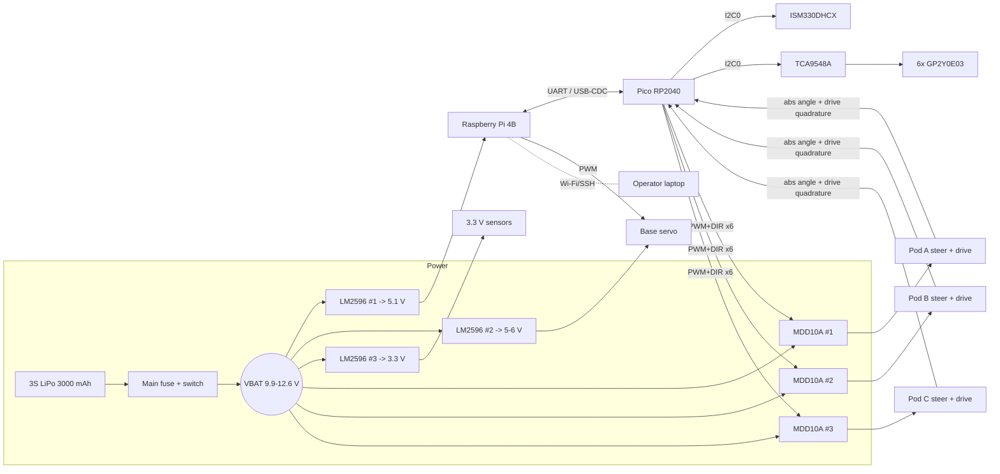

# 3-pod coaxial swerve drivetrain

## 1. Summary
A holonomic base with three independently steered and driven pods at 120° spacing. Each pod is **coaxial**: the drive power passes through the steering axis, so the steering can rotate continuously without twisting the drive wiring. A Raspberry Pi 4B handles Wi-Fi/SSH and the heavier computation; a Raspberry Pi Pico runs the time-critical PID loops and reads all sensors. Six short-range IR sensors give reactive obstacle stopping. A 5 V servo on the chassis provides a modifiable base (it is the base-yaw joint of the 4-DOF arm in `03_4dof_vr_teleop_arm.md`).

## 2. Architecture



### Responsibility split
| Function | Runs on | Rate |
|---|---|---|
| Wi-Fi, SSH, teleop input, logging | Pi 4B | event / 50 Hz |
| Chassis inverse kinematics (vx, vy, ω → pod angle + speed) | Pi 4B (or Pico; it is light) | 50-100 Hz |
| Odometry fusion (wheel FK + IMU heading) | Pi 4B, using raw data streamed from Pico | 100 Hz |
| Steering angle PID ×3, drive velocity PID ×3 | Pico | 500-1000 Hz |
| Encoder decoding (PIO), absolute pulse capture | Pico | continuous |
| IMU + IR sensor polling | Pico | IMU 200-400 Hz, IR ~50 Hz round-robin |
| Obstacle stop, command watchdog | Pico | every control tick |
| Base servo PWM | Pi 4B hardware PWM (GPIO18) | 50 Hz |

## 3. Bill of materials
| Qty | Part | Role | Library id |
|---|---|---|---|
| 1 | Raspberry Pi 4B | main compute, Wi-Fi/SSH | rpi4b |
| 1 | Raspberry Pi Pico | real-time control, sensor I/O | pico_rp2040 |
| 1 | ISM330DHCX breakout | 6-axis IMU for heading/pose | ism330dhcx |
| 6 | Sharp GP2Y0E03 | reactive obstacle detection (4-50 cm) | gp2y0e03 |
| 1 | TCA9548A breakout | resolves the shared 0x40 address | tca9548a |
| 3 | REV Through Bore Encoder V2 | absolute pod steering angle | rev_through_bore_v2 |
| 6 | Pololu 37D 12 V gearmotor w/ 64 CPR encoder | 3 steer + 3 drive | pololu_37d |
| 3 | Cytron MDD10A | dual 10 A drivers, one per pod (steer + drive) | cytron_mdd10a |
| 3 | LM2596 adjustable buck | 5 V Pi, 5 V servo, 3.3 V sensors | lm2596_adj |
| 1 | 3S LiPo 3000 mAh | main battery | lipo_3s_3000 |
| 1 | Hobby servo (5 V) | modifiable base / arm base yaw | — |
| — | Bevel gears / belts, bearings, wheels | coaxial pod mechanics | — |

Gear ratios of the 37D motors are not recorded. Typical choices: steering 131:1-150:1 (slow, high torque, fine angle resolution); drive 19:1-30:1 (speed). Record the actual ratios in `calibration.yaml`.

## 4. Power architecture
| Rail | Source | Loads | Notes |
|---|---|---|---|
| VBAT 11.1 V nom. | 3S LiPo via fuse + switch | 3x MDD10A (6 motors) | Worst-case stall 6 x 5.5 A = 33 A; fuse 25-30 A slow-blow, 14 AWG trunk, 18 AWG to each driver |
| 5.1 V Pi | LM2596 #1 | Pi 4B (+ Pico via VSYS if not USB-powered) | Pi needs 3 A; LM2596 is marginal. Set 5.1-5.2 V under load; consider a 5 A buck |
| 5-6 V servo | LM2596 #2 | base servo | isolated so servo stalls cannot brown out the Pi (design intent) |
| 3.3 V | LM2596 #3 | IMU, mux, 6x IR (36 mA each), 3x Through Bore | ~0.35 A total; LM2596 is oversized but fine |

Design rationale recorded by the builder: two separate 5 V converters so the Pi 4B never browns out from servo current draw; 3S LiPo chosen for stable and capable output.

**Watch item:** the Pololu 37D Hall encoders need 3.5-20 V and output A/B at their supply voltage. On a 3.3 V rail they are below spec; if powered from 5 V, their outputs exceed the Pico's 3.3 V limit. Recommended: power encoders from the 5 V servo rail or a small 5 V LDO and pass A/B through a 74LVC245/74AHCT-style level shifter or a 10 k/20 k divider.

## 5. Interfaces and suggested pin map
The builder did not record pin assignments; this map fits every signal on the Pico with one spare pin and respects RP2040 PWM slice independence.

### Pico (RP2040)
| GPIO | Function | Connects to |
|---|---|---|
| GP0 | UART0 TX | Pi GPIO15 (RXD) |
| GP1 | UART0 RX | Pi GPIO14 (TXD) |
| GP2, GP3 | PIO quadrature | Pod A drive encoder A/B (level-shifted) |
| GP4 | I2C0 SDA | ISM330DHCX SDA, TCA9548A SDA |
| GP5 | I2C0 SCL | ISM330DHCX SCL, TCA9548A SCL |
| GP6, GP7 | PIO quadrature | Pod B drive encoder A/B |
| GP8, GP9 | PIO quadrature | Pod C drive encoder A/B |
| GP10, GP11, GP12 | PIO pulse-width capture | Through Bore ABS (white) pods A, B, C |
| GP13 / GP14 | DIR / PWM (slice 7A) | MDD10A #1 ch1 - Pod A steer |
| GP15 / GP16 | DIR / PWM (slice 0A) | MDD10A #1 ch2 - Pod A drive |
| GP17 / GP18 | DIR / PWM (slice 1A) | MDD10A #2 ch1 - Pod B steer |
| GP19 / GP20 | DIR / PWM (slice 2A) | MDD10A #2 ch2 - Pod B drive |
| GP21 / GP22 | DIR / PWM (slice 3A) | MDD10A #3 ch1 - Pod C steer |
| GP27 / GP26 | DIR / PWM (slice 5A) | MDD10A #3 ch2 - Pod C drive |
| GP28 | spare | e-stop input or status LED |

PIO budget: 3 quadrature + 3 pulse-width = 6 of 8 state machines.

### TCA9548A channels
| Channel | Sensor | Suggested placement |
|---|---|---|
| 0 | IR front | 0° |
| 1 | IR front-left | 60° |
| 2 | IR rear-left | 120° |
| 3 | IR rear | 180° |
| 4 | IR rear-right | 240° |
| 5 | IR front-right | 300° |
| 6-7 | spare | |

A0-A2 low → mux at 0x70. ISM330DHCX at 0x6A or 0x6B on the upstream bus. Tie each GP2Y0E03 VIN(IO) to 3.3 V and GPIO1 high.

### Raspberry Pi 4B
| GPIO | Function |
|---|---|
| 14 / 15 | UART to Pico (enable `dtoverlay=disable-bt` or use mini-UART carefully; alternatively use USB-CDC to the Pico's USB port) |
| 18 | Hardware PWM to base servo signal (servo powered from the 5-6 V rail, grounds common) |
| 5 V / GND pins | from LM2596 #1 |

## 6. Mechanical / CAD notes
- **Layout**: pods on a circle of radius R at 90°, 210°, 330° (one pod forward). The support triangle is smaller than a 4-pod square base; keep the center of gravity low and near the centroid, especially with the arm mounted.
- **Coaxial pod**: steering motor turns the pod housing through a gear or belt; the drive motor is fixed to the chassis and transmits through a shaft concentric with the steering axis to a bevel pair at the wheel. Because drive passes through the steering axis, rotating the pod also turns the wheel: the **coupling ratio** must be compensated in software (see §7).
- **Through Bore V2** mounts concentric to the steering axis using its 1/2 in hex bore (inserts for 3/8 in hex, 5 mm hex, 1/4 in round); its zero is the case notch. Align the notch to a known pod heading and record the offset.
- **37D**: 37 mm body, 6 mm D-shaft, do not screw more than 3 mm into the gearbox face holes. Use Pololu's dimension PDF/STEP.
- **IMU** rigid, near the centroid, away from motor magnets.
- **IR sensors** at bumper height, angled slightly down, 4 cm minimum range means recess them ≥4 cm behind the bumper face or accept a blind zone.
- Leave a flat, reinforced mounting plate with the base servo for the arm (`arm4dof`).

## 7. Software
### Kinematics
Pod i at position (xᵢ, yᵢ) from the chassis center, chassis command (vx, vy, ω):

```
v_ix = vx - ω·y_i
v_iy = vy + ω·x_i
speed_i = hypot(v_ix, v_iy)
angle_i = atan2(v_iy, v_ix)
```
Angle optimization: if |wrap(angle_i − current_i)| > 90°, use angle_i + 180° and −speed_i. Scale all speeds down together if any exceeds the max.

Forward kinematics (odometry): stack the 3 pod velocity vectors into a 6x1 vector and solve the 6x3 least-squares system `[1 0 -y_i; 0 1 x_i] · [vx vy ω]ᵀ` with a precomputed pseudo-inverse. Replace ω with the IMU gyro rate when available; integrate in the world frame.

### Coaxial coupling compensation
`wheel_cmd_rad_s = drive_cmd_rad_s + k_couple · steer_rate_rad_s`, where k_couple is the bevel/gear ratio relating pod rotation to wheel rotation. Measure it: hold the drive motor still, rotate the pod one full turn, count wheel revolutions.

### Control loops (Pico)
- Steering: PID on absolute angle (wrap error to ±180°), output → MDD10A PWM 18-20 kHz. Feedforward optional.
- Drive: velocity PID on drive encoder counts/s (CPR at wheel = 64 x gear ratio x bevel ratio), with kV feedforward.
- Safety: if any IR sensor in the direction of travel reads below threshold, zero the velocity component toward it (or full stop); if no valid command for 200 ms, stop all motors.

### Suggested module layout
```
pico_fw/            (C/C++ pico-sdk or MicroPython; C recommended for 1 kHz loops)
  main.c            fixed-rate loop via repeating_timer
  pio_quadrature.pio
  pio_pwm_capture.pio
  pid.c             PID with anti-windup, derivative on measurement
  mdd10a.c          PWM+DIR abstraction
  sensors.c         ISM330DHCX + TCA9548A + GP2Y0E03 drivers
  link.c            framed UART protocol + watchdog
pi_sw/              (Python or ROS 2)
  link.py           serial framing, CRC-16
  kinematics.py     IK/FK above
  odometry.py       FK + IMU fusion
  teleop.py         gamepad/keyboard over SSH or web UI
  config/calibration.yaml
```

### Link protocol (suggested)
`0xAA | len | msg_id | payload | CRC-16/CCITT`. Pi→Pico: `SET_POD_TARGETS {angle[3] (int16 cdeg), speed[3] (int16 mm/s)}` at 50-100 Hz. Pico→Pi: `STATE {abs_angle[3], drive_counts[3], gyro[3], accel[3], ir_mm[6], flags}` at 100 Hz.

## 8. Known challenges and lessons
- Shared I2C address of all GP2Y0E03 units → solved with the TCA9548A.
- Servo current draw browning out the Pi → solved with a dedicated 5 V converter.
- Accurate position needs both IMU and encoders; wheel-only odometry drifts with scrub/slip on swerve.
- Check: LM2596 headroom for the Pi rail, and encoder voltage levels into the Pico (see §4).

## 9. Open items to confirm
- [ ] Gear ratios of steer and drive 37D motors; bevel ratio; wheel diameter; pod circle radius R.
- [ ] Pi↔Pico link: UART or USB-CDC? baud rate?
- [ ] Firmware language (C/MicroPython) and Pi software stack (plain Python / ROS 2).
- [ ] How the encoders are powered and level-shifted.
- [ ] Servo model and voltage on the "modifiable base".

## 10. Verification checklist
- [ ] Each buck set and measured under load before connecting boards.
- [ ] `vcgencmd get_throttled` returns 0x0 during full-speed driving with servo moving.
- [ ] Each pod's absolute angle reads correctly over 360° and its zero offset is recorded.
- [ ] Drive encoder direction matches motor direction on every pod.
- [ ] Coupling ratio measured; wheel does not creep when only steering.
- [ ] Watchdog stops motors within 250 ms of unplugging the link.
- [ ] Obstacle stop triggers at the set distance in all six directions.
- [ ] Odometry error < target (e.g., 2% of distance) on a 3 m square path.
