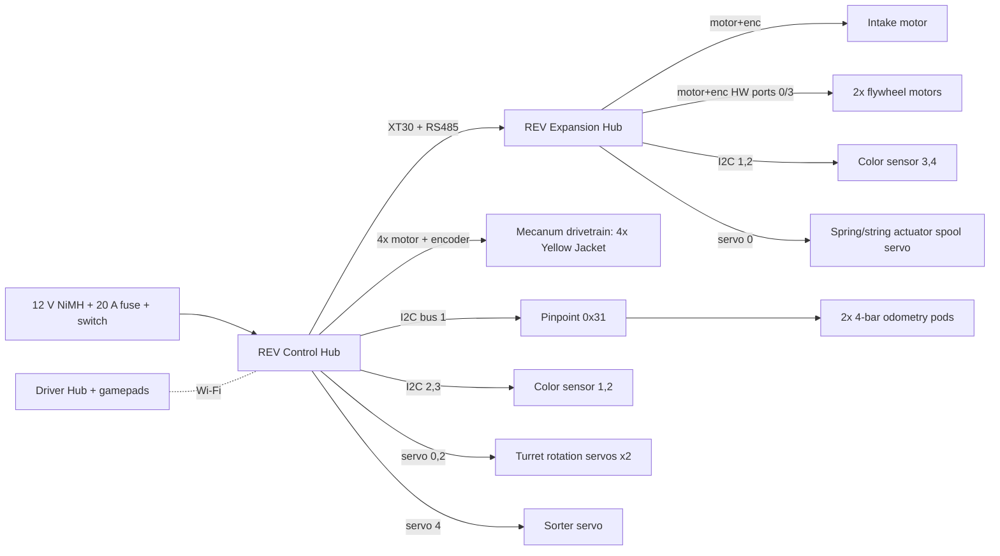

# FTC robot (DECODE season)

## 1. Summary
A mecanum-drive FTC robot that intakes game artifacts, classifies them by color, sorts them, and feeds them with a string-driven, spring-loaded telescoping actuator into a two-motor flywheel turret that tracks the goal. REV and goBILDA parts were chosen because they are well documented and work out of the box with the FTC SDK.

> **Season note for agents:** this robot was built for 2025-2026 DECODE. The FTC season is now 2026-2027 (BIOBUZZ). Re-read the current Competition Manual's robot construction (R) rules for motor/servo limits, legal parts, sizing and wiring before reusing this design.

## 2. Architecture

## 3. Bill of materials
| Qty | Part | Role | Library id |
|---|---|---|---|
| 1 | REV Control Hub | main controller (Android, Wi-Fi, 4 motors, 6 servos, 4 I2C) | rev_control_hub |
| 1 | REV Expansion Hub | extra 4 motors / 6 servos / 4 I2C | rev_expansion_hub |
| 1 | goBILDA Pinpoint | odometry sensor fusion (2 pods + internal IMU, 1500 Hz) | gobilda_pinpoint |
| 2 | goBILDA 4-bar odometry pod (32 mm) | X and Y dead wheels, 2000 CPR | gobilda_4bar_pod |
| 7 | goBILDA 5203 Yellow Jacket | 4 drive, 1 intake, 2 flywheel | gobilda_yellow_jacket_5203 |
| 4 | Color sensor (assumed REV Color Sensor V3) | classify purple/green artifacts | rev_color_sensor_v3 |
| 4 | Servos (model not recorded) | 2 turret rotation, 1 sorter, 1 actuator spool | — |
| 4 | Mecanum wheels | holonomic drive | — |
| 1 | 12 V NiMH FTC battery, 20 A fuse, power switch | power | ftc_12v_nimh |

Design rationale recorded by the builder: two flywheel motors for the shooter so the turret does not suffer large rotational-velocity fluctuations between shots.

## 4. Port allocation (suggested; record the real one)
| Hub | Port | Device | Notes |
|---|---|---|---|
| Control Hub | Motor 0-3 + Enc 0-3 | front-left, rear-left, front-right, rear-right drive | drivetrain on one hub = same-cycle bulk read |
| Expansion Hub | Motor 0 + Enc 0 | flywheel A | encoder ports 0 and 3 are hardware-decoded → use for high-speed flywheels |
| Expansion Hub | Motor 3 + Enc 3 | flywheel B | |
| Expansion Hub | Motor 1 + Enc 1 | intake | |
| Expansion Hub | Motor 2 | spare | |
| Control Hub | I2C 0 | internal IMU only | do not add devices |
| Control Hub | I2C 1 | Pinpoint (0x31) | |
| Control Hub | I2C 2, 3 | color sensors 1, 2 (0x52 each) | fixed address → one per bus |
| Expansion Hub | I2C 1, 2 | color sensors 3, 4 | |
| Control Hub | Servo 0, 2 | turret rotation L/R | separate power pairs (0-1, 2-3, 4-5) for high-current servos |
| Control Hub | Servo 4 | sorter rotation | |
| Expansion Hub | Servo 0 | actuator spool | |

Odometry pods plug into the Pinpoint, not into hub encoder ports, leaving 1 hub encoder port free.

## 5. Power
- 12 V NiMH → 20 A ATM fuse → labeled main switch → Control Hub XT30 → Expansion Hub XT30 (daisy chain).
- Each Yellow Jacket stalls at 9.2 A @ 12 V; 7 motors can exceed the fuse if stalled together. Use current-limited acceleration on drive, and do not run intake into a jam.
- Servo + 5 V aux share a 5 A budget per hub; keep the two turret servos on different power pairs, or add a REV Servo Power Module if they are high-torque servos.

## 6. Mechanical / CAD notes
- **Chassis**: goBILDA channel on the 16 mm/8 mm hole pattern, M4 hardware, 8 mm REX shafts. Yellow Jacket faces: 4x M4 on 16 mm square.
- **Odometry**: X (forward) pod and Y (strafe) pod, spring-loaded 4-bar, fit inside 43 x 43 mm profiles. Measure pod offsets in mm from the tracking point and enter them in the Pinpoint config.
- **Intake → sorter → actuator → turret**: artifacts are classified by color sensors at the sorter; the sorter (servo-indexed) aligns the next correct artifact; the telescoping string-driven, spring-loaded linear actuator transfers it up into the turret. String winds onto a servo spool to retract/load, spring extends (or vice versa - record which).
- **Turret**: 2 servos drive the turret ring; 2 flywheel motors on the turret (or fixed with a turret-mounted hood). Add mass (flywheel inertia) to reduce speed drop per shot.
- Respect the current manual's starting-size and extension limits.

## 7. Software
- **Stack**: FTC SDK (Java, Android Studio), LinearOpMode for TeleOp and Autonomous.
- **Bulk reads**: `for (LynxModule hub : hardwareMap.getAll(LynxModule.class)) hub.setBulkCachingMode(LynxModule.BulkCachingMode.AUTO);`
- **Localization**: `GoBildaPinpointDriver` - set `setEncoderResolution(goBILDA_4_BAR_POD)`, pod offsets, encoder directions; call `resetPosAndIMU()` only while stationary; call `update()` every loop; read `getPosition()` (Pose2D, mm + rad). Path following via Pedro Pathing or Road Runner (both support Pinpoint).
- **Mecanum IK**: `fl = y + x + r; bl = y − x + r; fr = y − x − r; br = y + x − r`, normalize by max(|…|, 1). Field-centric: rotate (x, y) by −heading first.
- **Flywheels**: `DcMotorEx.setVelocity(ticks_per_s)` with tuned PIDF (`setVelocityPIDFCoefficients`); F ≈ 32767 / max_ticks_per_s. Gate shots on |v − v_target| < tolerance.
- **Turret aiming (odometry-based)**: `turret_angle = wrap(atan2(goal_y − y, goal_x − x) − heading)`; clamp to mechanical limits; map to servo position. Optional: AprilTag/vision correction (camera not recorded).
- **Sorter**: state machine `IDLE → DETECT (color) → INDEX (rotate sorter) → READY → TRANSFER (actuator) → SHOOT`. Classify purple vs green by hue from normalized RGB (and proximity to confirm presence); calibrate per sensor.
- **Telemetry**: loop time, pose, flywheel speed, sorter state, detected colors.

## 8. Known challenges and lessons
- Flywheel speed sag between consecutive shots → two motors (more torque, faster recovery).
- REV/goBILDA chosen for documentation and out-of-box FTC compatibility.
- Color sensors share one I2C address → spread across buses.

## 9. Open items to confirm
- [ ] Yellow Jacket ratios per mechanism; wheel diameter (mecanum size).
- [ ] Exact servo models (speed/torque, 180° vs continuous) and turret gear ratio.
- [ ] Color sensor model (V3 assumed).
- [ ] Goal-tracking method: odometry-only or camera/AprilTag.
- [ ] Path-planning library used.

## 10. Verification checklist
- [ ] Pinpoint reports distance within 1% over a 2 m tape-measured push in X and Y.
- [ ] Heading returns to 0 ± 1° after 10 spins.
- [ ] Each color sensor classifies 20/20 artifacts of each color under event-like lighting.
- [ ] Flywheel recovers to within tolerance between 3 rapid shots.
- [ ] Robot passes the current season's inspection checklist.
