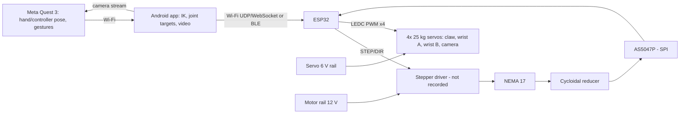

# 4-DOF VR-teleoperated robot arm

## 1. Summary
An arm meant to sit on the 3-pod swerve. The operator wears a Meta Quest 3; hand/arm tracking and gesture data go to an Android app that computes inverse kinematics and actuator commands and sends them to an ESP32. The phone rides on a servo-driven swivel on the arm and streams its camera back into the headset, so the operator controls the arm by moving their own arm while seeing from the robot's viewpoint.

Mechanical highlights: a 3D-printed **cycloidal drive** driven by a NEMA 17 (open loop, checked by an AS5047P), a **servo-driven differential wrist** using belts and herringbone bevel gears to reduce backlash, with the wrist servos placed near the base to pull the center of gravity toward the base.

## 2. Joint layout (inferred - confirm)
| Joint | Motion | Actuator | Where the actuator sits |
|---|---|---|---|
| J1 | base yaw | servo on the drivetrain ("modifiable base" servo of swerve3) | chassis |
| J2 | shoulder pitch | NEMA 17 → cycloidal reducer, AS5047P on stage | base |
| J3 | wrist pitch | differential: servo A + servo B (sum) | near base, belts up the arm |
| J4 | wrist roll | differential: servo A − servo B (difference) | near base |
| — | gripper | claw servo | wrist |
| — | camera swivel | servo holding the Android phone | upper arm/base |

If there is no elbow, the arm can control the gripper's direction (yaw + pitch) and orientation, but not its distance from the shoulder; add an elbow (another cycloidal stage) for full 3D position.

## 3. Architecture



## 4. Bill of materials
| Qty | Part | Role | Library id |
|---|---|---|---|
| 1 | ESP32 dev board | actuator control, wireless link | esp32 |
| 1 | Android phone + custom app | IK, command generation, camera streaming | — |
| 1 | Meta Quest 3 | operator tracking + video display | — |
| 1 | NEMA 17 stepper | drives the cycloidal reducer | nema17 |
| 1 | Stepper driver (not recorded; TMC2209 recommended) | | tmc2209 |
| 1 | AS5047P breakout + diametric magnet | absolute angle on cycloidal stage | as5047p |
| 4 | 25 kg-cm digital servos | claw, 2x wrist differential, camera swivel | servo_25kg |
| — | GT2 belts + pulleys, printed herringbone bevel gears, bearings, cycloidal pins/rollers | transmission | — |

## 5. Power (not recorded - recommended design)
| Rail | Loads | Sizing |
|---|---|---|
| 6-6.8 V servo rail (dedicated BEC/buck ≥ 10 A) | 4x 25 kg servos | stall ~2-3 A each; 4 x 3 A x 0.5 = 6 A minimum, 10 A for transients; 2200 µF at the servo bus |
| 12 V motor rail | stepper driver | NEMA 17 at ~1-1.5 A RMS |
| 5 V / 3.3 V logic | ESP32, AS5047P (3.3 V mode) | ESP32 on its own regulator; never share with servos |
If mounted on the swerve, the arm can draw from the swerve's 3S LiPo through its own fuse and regulators.

## 6. Suggested ESP32 pin map
| GPIO | Function | Notes |
|---|---|---|
| 18 / 19 / 23 / 5 | SPI SCK / MISO / MOSI / CS → AS5047P | AS5047P in 3.3 V mode (VDD tied to VDD3V3); SPI mode 1 |
| 25 | STEP | |
| 26 | DIR | |
| 27 | EN (active low) | disable on link loss |
| 32 | Servo claw (LEDC ch0, 50 Hz) | |
| 33 | Servo wrist A (LEDC ch1) | |
| 13 | Servo wrist B (LEDC ch2) | |
| 14 | Servo camera swivel (LEDC ch3) | GPIO14 outputs PWM briefly at boot; acceptable for a camera servo |
| 16 / 17 | UART2 to TMC2209 (if used) | not available on WROVER modules (PSRAM uses them) |
Avoid GPIO0, 2, 12, 15 for outputs; GPIO34-39 are input-only.

## 7. Mechanical / CAD notes
### Cycloidal reducer
- Single-stage ratio with N ring pins and N−1 disc lobes: **i = N − 1** (output from the disc via output pins).
- Disc profile (widely used parametric form; verify clearance in CAD):
  ```
  x(t) =  R·cos t − r_p·cos(t + ψ) − e·cos(N·t)
  y(t) = −R·sin t + r_p·sin(t + ψ) + e·sin(N·t)
  ψ    = −atan( sin((1−N)·t) / ( R/(e·N) − cos((1−N)·t) ) )
  ```
  R = ring-pin circle radius, r_p = ring-pin radius, e = eccentricity, N = number of ring pins, t ∈ [0, 2π].
- Output-pin holes in the disc: diameter = output pin diameter + 2e.
- Use two discs 180° out of phase to cancel the eccentric imbalance.
- Printed parts: e ≥ 1 mm, ring pins as steel dowels or bearings to reduce friction; offset the profile inward ~0.1-0.2 mm for print tolerance.
- NEMA 17 mount: 4x M3 on 31 mm square, 22 mm pilot, 5 mm shaft into the eccentric cam.
- AS5047P: diametric magnet on the output (or input) axis center, magnet pocket concentric, air gap per datasheet; ensure no steel near the magnet.

### Differential wrist
- Two input bevels (driven by servo A and servo B through belts) mesh with one output bevel carrying the gripper.
- Kinematics (equal gear ratio g):
  `pitch = g·(θA + θB)/2`, `roll = g·(θA − θB)/2` → `θA = (pitch + roll)/g`, `θB = (pitch − roll)/g`.
- Herringbone teeth cancel axial thrust and reduce backlash; belts let the heavy servos sit near the base (lower moment on the shoulder).
- Check servo range: pitch + roll must stay within each servo's travel (180° or 270° variant).

## 8. Software
### Data pipeline
1. **Quest 3 app** (Unity/OpenXR or native): read hand or controller pose and gestures (e.g., pinch → claw close); send pose (position + quaternion) at 60-90 Hz.
2. **Android app**: transform the operator pose into the robot base frame (calibrate with a "zero pose" gesture), solve IK, apply joint limits and rate limits, send joint targets to the ESP32 at 50-100 Hz; stream the phone camera to the Quest (WebRTC or MJPEG over Wi-Fi).
3. **ESP32**: receive targets, run stepper trapezoidal profiles (e.g., FastAccelStepper), compare stepper position with AS5047P angle and correct missed steps, output servo pulses, enforce limits, stop on link loss (> 250 ms without a packet).

### IK (for the inferred layout)
`J1 = atan2(y, x)`; `J2 = atan2(z − h_shoulder, hypot(x, y))`; wrist pitch/roll from the hand orientation relative to the forearm; claw from pinch distance. If an elbow exists, use the standard 2-link planar solution for J2/J3.

### Suggested packet (UDP, little-endian)
`seq u16 | j1_cdeg i16 | j2_cdeg i16 | wrist_pitch_cdeg i16 | wrist_roll_cdeg i16 | claw_pct u8 | cam_cdeg i16 | flags u8 | crc16`

## 9. Known challenges and lessons
- Backlash in printed wrists → herringbone bevels + belts.
- Arm weight on the shoulder → servos moved toward the base.
- Open-loop stepper can skip under load → AS5047P on the cycloidal stage provides a check/correction.
- End-to-end latency (tracking → IK → network → actuation, and camera → headset) drives operator comfort; target < 100 ms motion and < 150 ms video.

## 10. Open items to confirm
- [ ] Joint layout (is there an elbow?) and link lengths.
- [ ] Stepper driver model; servo model and voltage; arm power source.
- [ ] Transport Android ↔ ESP32 (Wi-Fi UDP, WebSocket, BLE) and Quest ↔ Android.
- [ ] Cycloidal parameters: N, e, R, r_p, ratio.
- [ ] Where the AS5047P magnet sits (input vs output).

## 11. Verification checklist
- [ ] Servo rail holds > 5.5 V with all four servos stalled briefly.
- [ ] AS5047P angle tracks commanded stepper angle within the backlash budget over full range.
- [ ] Wrist pitch and roll move independently with no cross-coupling.
- [ ] Link loss stops all motion and disables the stepper within 250 ms.
- [ ] Operator round-trip latency measured and recorded.
