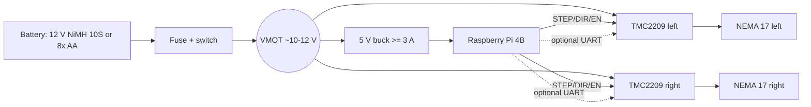

# Open-loop stepper differential drive

## 1. Summary
A three-wheel robot: two differentially driven wheels on NEMA 17 steppers and one idler (caster). A Raspberry Pi 4B computes the motor commands locally. There are no sensors; position comes entirely from counting commanded steps. TMC2209 drivers were chosen for current capacity and 256 microstepping.

## 2. Architecture



## 3. Bill of materials
| Qty | Part | Role | Library id |
|---|---|---|---|
| 1 | Raspberry Pi 4B | compute, step generation | rpi4b |
| 2 | NEMA 17 stepper | wheel drive | nema17 |
| 2 | TMC2209 module | stepper drivers (current capacity, 256 µsteps) | tmc2209 |
| 1 | 5 V buck converter (≥ 3 A) | Pi power | — |
| 1 | Battery (see §4) | | — |
| 2 + 1 | drive wheels + idler/caster | | — |

## 4. Power architecture - discrepancy to resolve
Two power descriptions were recorded for this project:
- **A:** 12 V NiMH battery (10S) "for safety".
- **B:** 8x AA batteries for a nominal 10-11 V, with a 5 V buck for the Pi.

Both sit inside the TMC2209's 4.75-29 V motor supply range. Notes:
- 8x NiMH AA = 9.6 V nominal; 8x alkaline AA = 12 V fresh, sagging to ~10 V under load. Alkaline cells have high internal resistance and will sag hard under stepper + Pi load.
- The Pi needs 5 V at 3 A: the buck must be rated ≥ 3 A continuous with input down to the battery's loaded minimum.
- Steppers draw current even when stationary (holding); use the TMC2209's standstill current reduction (IHOLD) to save battery.

## 5. Wiring and suggested Pi pin map
| Pi GPIO (BCM) | Signal | Notes |
|---|---|---|
| 17 | STEP left | |
| 27 | DIR left | |
| 22 | STEP right | |
| 23 | DIR right | |
| 24 | EN (both, active low) | disable to free-wheel / save power |
| 14 (TXD) | UART TX → both TMC2209 PDN_UART via 1 kΩ | optional, for VACTUAL / current / microstep config |
| 15 (RXD) | UART RX ← PDN_UART | single-wire half duplex |
TMC2209 addresses via MS1/MS2: left = 0, right = 1. VIO = 3.3 V from the Pi; GND common; 100 µF+ electrolytic across VMOT at each module.

Note: "2x NEMA 17 motor drivers" in the original notes is read as 2x NEMA 17 motors driven by the 2x TMC2209.

## 6. Mechanical / CAD notes
- Wheels on a common axis through the robot's center of mass for in-place turning; idler at front or rear.
- Couple wheels directly to the 5 mm motor shaft with a set-screw or clamping hub (flat on the shaft); support wheel load with a bearing if the wheel is wide or the robot heavy - stepper bearings are not meant for large radial loads.
- NEMA 17 mount: 4x M3 on 31 mm square, 22 mm pilot.
- Use identical wheels; measure the effective diameter of each wheel after mounting (tires compress).

## 7. Software
### Kinematics
```
steps_per_m = (200 · microsteps) / (π · d_wheel)
v_L = v − ω·b/2,  v_R = v + ω·b/2           (b = track width)
step_rate_L = v_L · steps_per_m_L,  step_rate_R = v_R · steps_per_m_R
odometry: Δs = (Δs_L + Δs_R)/2, Δθ = (Δs_R − Δs_L)/b
```
Use per-wheel `steps_per_m` (calibrated) to absorb diameter differences.

### Timing (the root of the straight-line problem)
Linux user-space toggling of STEP pins jitters by hundreds of microseconds, so the two wheels do not receive identical step trains. Options, best first:
1. **TMC2209 VACTUAL over UART**: the driver's internal pulse generator runs each motor at a commanded velocity with no STEP pulses; update both drivers back-to-back. (Position must then be integrated from commanded velocity x time.)
2. **DMA-timed waveforms** (pigpio `wave_*`) generating both channels from one timebase.
3. Offload step generation to a small MCU (Pico) - the swerve's SBC + MCU pattern.
4. If staying with software timing: generate both channels from one loop using Bresenham-style step interleaving so ratios stay exact.

### Calibration
1. Drive 2 m straight; measure lateral drift → adjust the per-wheel steps_per_m ratio.
2. Rotate 10 turns in place; measure angle error → adjust effective track width b.
3. Repeat the UMBmark square test (clockwise and counter-clockwise) for systematic errors.

## 8. Known challenges and lessons
- **Difficult to travel in a straight line** → troubleshooted by synchronizing the two motors in code. The likely causes are step-timing jitter, unequal wheel diameters and mismatched microstep settings; see §7 for robust fixes.
- No sensors: any missed step is invisible. Keep accelerations within pull-out torque, or add wheel encoders/IMU later.

## 9. Open items to confirm
- [ ] Which battery is current (A or B) and its capacity.
- [ ] Microstep setting actually used and driver current.
- [ ] Step generation method (Python GPIO, pigpio, other).
- [ ] Wheel diameter and track width.

## 10. Verification checklist
- [ ] Pi stays un-throttled (`vcgencmd get_throttled` = 0x0) at full speed.
- [ ] Driver temperature stable after 10 min of driving.
- [ ] Straight-line drift < 2 cm over 2 m after calibration.
- [ ] 360° spin error < 2° after calibration.
