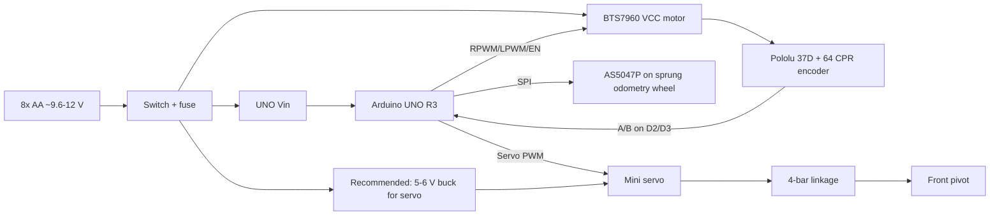

# Tripod narrow competition vehicle

## 1. Summary
A narrow, three-point ("tripod") vehicle for a path-following/distance competition. One Pololu 37D gearmotor drives the vehicle through a BTS7960 H-bridge; a mini servo turns the front pivot through a 4-bar linkage. A custom spring-loaded odometry wheel read by an AS5047P magnetic encoder gives accurate forward distance/path tracking independent of drive-wheel slip. An Arduino UNO R3 runs everything from 8x AA cells, taking battery voltage directly on Vin.

## 2. Architecture

## 3. Bill of materials
| Qty | Part | Role | Library id |
|---|---|---|---|
| 1 | Arduino UNO R3 | control (Vin accepts the pack voltage directly) | arduino_uno_r3 |
| 1 | Pololu 37D 12 V gearmotor + 64 CPR encoder | propulsion | pololu_37d |
| 1 | BTS7960 module | H-bridge | bts7960 |
| 1 | Mini servo (e.g., 9 g class) | steering via 4-bar | — |
| 1 | AS5047P breakout + diametric magnet | odometry wheel angle | as5047p |
| 1 | Custom sprung odometry wheel | slip-free distance | — |
| 8 | AA cells + holder | power | — |

## 4. Power architecture
As built: 8x AA feed everything; no buck because the UNO's Vin accepts up to 12 V (recommended 7-12 V).

Risks to address in a similar design:
- **Servo supply**: a mini servo must not see 9.6-12 V. If it runs from the UNO's 5 V pin, the on-board linear regulator dissipates (Vin − 5 V) x I_servo - about 1.4-2 W at 200-300 mA, which overheats it and can reset the board. Use a small 5-6 V buck/BEC for the servo.
- **Brownouts**: the 37D (12 V version) can stall at 5.5 A; AA cells sag under that, and once Vin drops below roughly 6-7 V the UNO's 5 V rail falls out of regulation, which can reset the board or corrupt sensor reads. Add 1000 µF at the BTS7960 input, soft-start the motor (PWM ramp), and prefer NiMH (lower internal resistance) or a 3S LiPo with a buck if rules allow.
- 8x alkaline fresh = 12 V (top of UNO's recommended range); 8x NiMH = 9.6 V.

## 5. Suggested UNO pin map
| UNO pin | Function | Notes |
|---|---|---|
| D2 (INT0) | 37D encoder A | hardware interrupt |
| D3 (INT1) | 37D encoder B | hardware interrupt; powering the encoder at 5 V is within its 3.5-20 V range and matches UNO logic |
| D5 | BTS7960 RPWM | Timer0 PWM (~980 Hz) |
| D6 | BTS7960 LPWM | Timer0 PWM |
| D7 | BTS7960 R_EN + L_EN (tied) | high = enabled |
| A0 / A1 | BTS7960 R_IS / L_IS | current sense (scale per module) |
| D9 | Servo signal | Servo library (Timer1) disables PWM on D9/D10, fine here |
| D10 | AS5047P CSn | SPI SS (must be output on UNO) |
| D11 / D12 / D13 | AS5047P MOSI / MISO / SCK | SPI mode 1; AS5047P in 5 V mode (VDD = 5 V, 1 µF on VDD3V3) |
| A2 | battery voltage via divider (e.g., 30 k / 10 k) | low-battery detection |
Reading the AS5047P over SPI (absolute 14-bit, unwrapped in software) avoids needing a third and fourth interrupt for its ABI outputs. Poll at ≥ 1 kHz so the wheel never turns more than half a revolution between reads.

## 6. Mechanical / CAD notes
- **Layout** (assumed - confirm): one steered front wheel on a pivot, two rear wheels, one 37D driving the rear axle (directly or via gears). Narrow track width.
- **Rollover**: a tricycle tips over the line between the front contact and one rear wheel. Keep the center of gravity low and close to the rear axle; limit lateral acceleration `v²/r < g · d / h` where d = horizontal distance from the CG to the tipping line and h = CG height. Turning radius `r = L / tan(δ)` (L = wheelbase, δ = steer angle).
- **4-bar steering**: servo horn → coupler → pivot arm. The servo-to-steer-angle relation is nonlinear; build a lookup table from measured angles at several servo pulses. Make the linkage stiff (no slop) - it sets path accuracy.
- **Sprung odometry wheel**: thin, hard wheel on a swing arm with a light spring; mount on the vehicle centerline; magnet centered on the wheel axle with the AS5047P facing it at the datasheet air gap. Calibrate mm per count by rolling a measured distance.
- 37D: 6 mm D-shaft; do not screw more than 3 mm into gearbox face holes.

## 7. Software
- **Loop**: fixed 1 kHz timer for AS5047P reads + odometry; 100-200 Hz for speed PID and steering updates.
- **Odometry**: distance from the odometry wheel (unwrap 14-bit angle → counts → mm). Heading estimate from the bicycle model `dθ = ds · tan(δ) / L` using the calibrated steer angle (add an IMU if heading accuracy matters).
- **Speed control**: PID on 37D encoder velocity (or odometry-wheel velocity) → BTS7960 PWM; ramp limits to avoid brownout.
- **Path following**: pure pursuit on the bicycle model, or a scripted distance/steer-angle profile for a fixed competition course.
- **Stop accuracy**: decelerate on a profile and stop on odometry distance, not on time.

## 8. Known challenges and lessons
- UNO chosen for simplicity; direct battery feed avoided a buck converter.
- A dedicated odometry wheel decouples distance measurement from drive-wheel slip.
- Watch servo supply and brownouts (see §4).

## 9. Open items to confirm
- [ ] Which wheels are driven (one rear wheel, rear axle?) and gear ratio of the 37D.
- [ ] Wheelbase L, track width, odometry wheel diameter.
- [ ] Servo model and how it is powered.
- [ ] Competition rules (distance, time, target accuracy).

## 10. Verification checklist
- [ ] UNO does not reset during full-throttle starts and stalls.
- [ ] Odometry wheel distance error < 0.5% over the course length.
- [ ] Steering lookup table reproduces the measured turning radius at 3+ angles.
- [ ] Vehicle does not tip at max speed and max steer angle.
